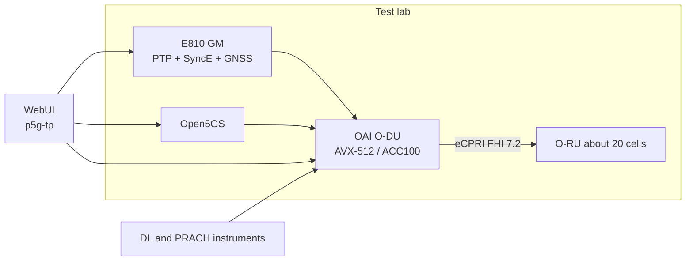
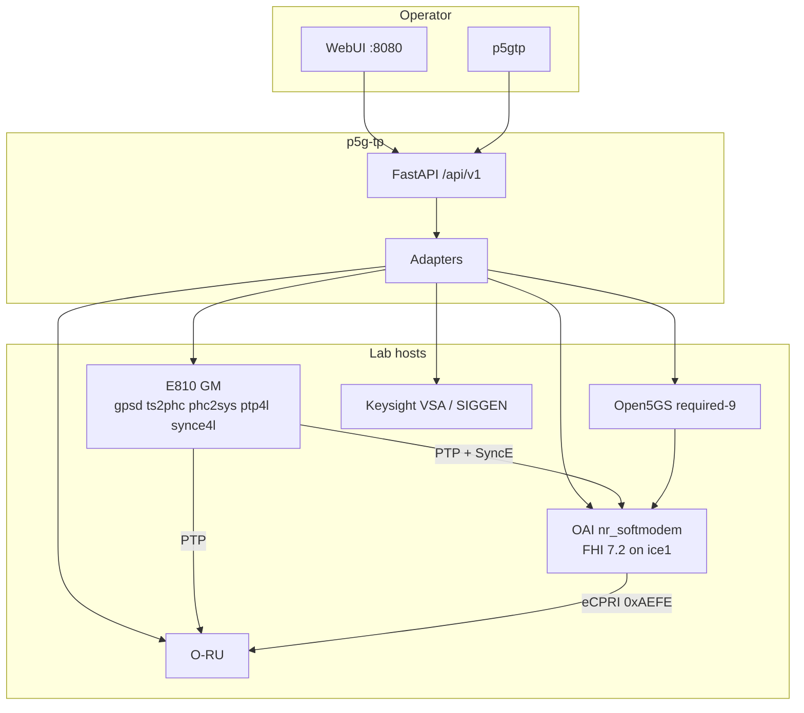
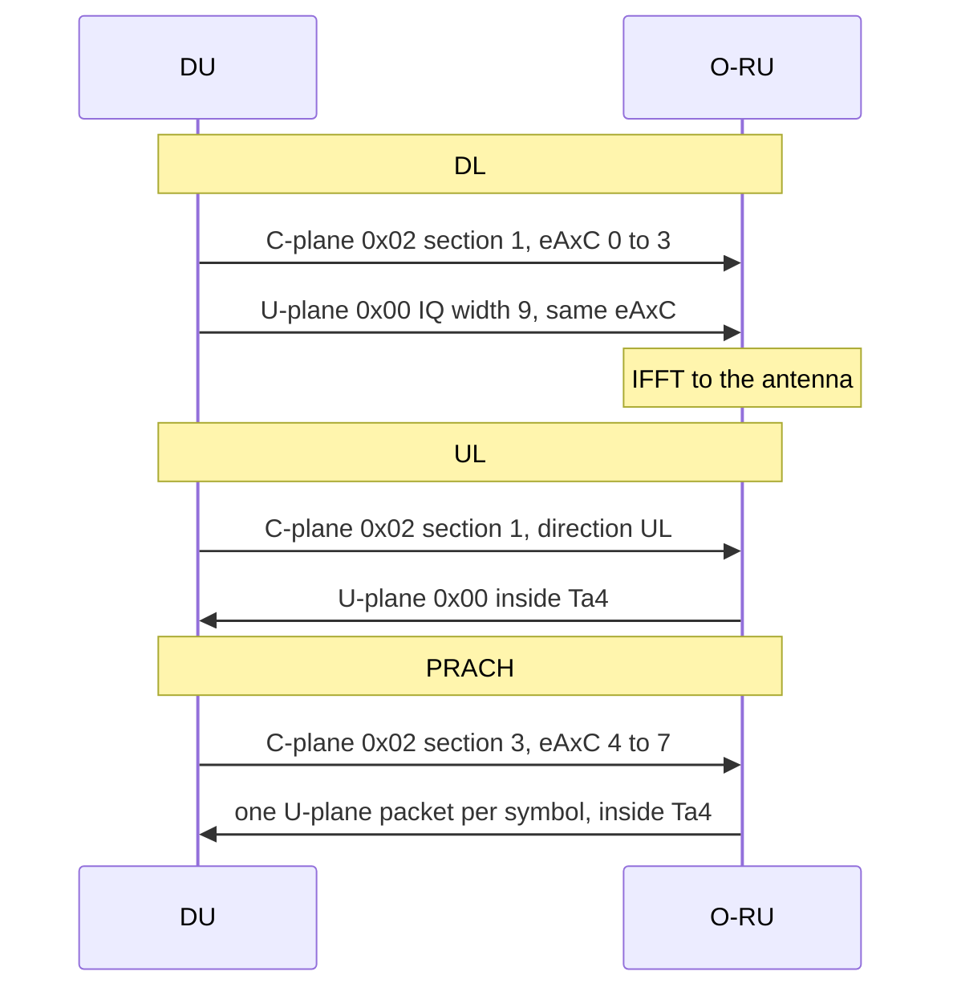
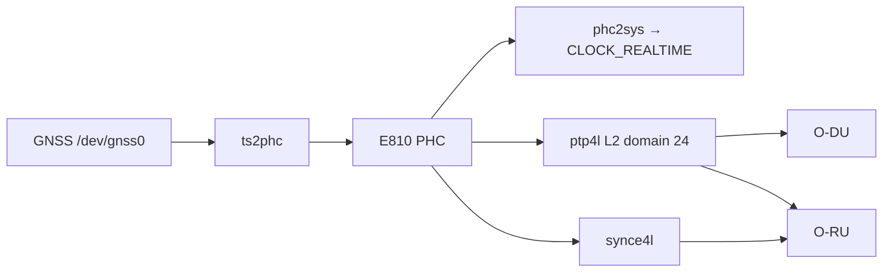
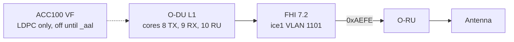
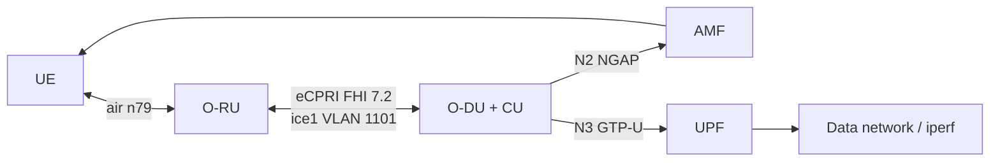

# Open5G RAN knowledge

Lab and DU prototype in `open5g-ran-core`. O-DU is OpenAirInterface (`sources/openairinterface5g-v26.w14`). Core is Open5GS. Timing is Intel E810 with linuxptp and synce4l. The test platform and WebUI are `sources/p5g-tp-26.0.1`.

## Summary

LATUAN proposed and built this RAN test platform, then a prototype whose target is a high-performance DU and an AI-RAN roadmap.

- **Testbed.** Studied the lab environment and the open-source stack, then stood up the test lab: timing, 5G core, and the RAN on one bench.
- **Whole network.** Owns timing (E810 grandmaster, PTP, SyncE, GNSS), the core (Open5GS), and the RAN (OAI gNB, O-RAN FHI 7.2 fronthaul).
- **DU performance.** Ported the DU onto AVX-512, isolated CPU cores, and designed ACC100 LDPC offload (`LATUAN_ACC100_LDPC`) so one server can move toward a dense RU load of about 20 cells.
- **RAN test instruments, Keysight-style.** Added downlink and PRACH tools that the lab uses instead of an external analyzer. DL: IQ capture, OFDM grid, constellation, and EVM (`tests/testmode`). PRACH: preamble energy and delay from the gNB log (`tests/prach`). The WebUI exposes the same ideas as DU Test Studio, VSA, and PRACH analytics.
- **TM3.1a and E2E traffic.** Optimizes the downlink test mode (TM3.1a) across 20, 40, 50, 60, 80, and 100 MHz, and optimizes end-to-end traffic on the same bandwidth set. Profiles live in `configs/gnb` (n79, 30 kHz, FHI 7.2). Tracking: `docs/gnb_dl_optimize_tracking.md`, guide: `docs/oai_tm3_1a_test_guide.md`.
- **WebUI.** Built the operator UI in `sources/p5g-tp-26.0.1/webui`: RAN fleet, O-DU and O-RU, M-plane, timing, core, iperf, and the test studio.
- **AI-RAN.** The performance work (dense RUs, hardware offload, the test platform) is the base of the AI-RAN roadmap. DU development continues on this tree.
- **SAS and RU verification.** Studies the O-RAN Security Assurance Specification (SAS) and supports the automation test framework used to verify the RU. This item is in progress and is updated continuously. In this tree the framework side is Robot Framework (`sources/robotframework-7.4.2/workspace_oam`) and the Test Controller automation (`sources/p5g-tp-26.0.1/docs/design/details/01_test_measurement/automation_controller.md`, O-RU verify plans).
- **Lab agents and Keysight automation.** Builds the site agents that run the lab (GnbAgent, TimingAgent, CoreAgent) so the Integrated RAN test platform can automate tests against Keysight instruments. In progress. Contracts: `des-009_gnb_agent.md`, `des-010_timing_agent.md`, `des-011_core_agent.md`. Keysight VSA is the SCPI path on the Test Controller (`testbed_inventory.md`).

## Quick view

| Piece | Role | Where |
| --- | --- | --- |
| Timing | Grandmaster for the RU. PTP, SyncE, GNSS, IRQ and CPU isolation. | `scripts/timing`, `docs/timing_checklist.md` |
| Core | User-plane and control-plane core behind the DU. | `docs/open5gs_guide.md`, WebUI `core/` |
| DU | High-PHY and O-RAN fronthaul. DL optimize and ACC100 LDPC. | `sources/openairinterface5g-v26.w14`, `docs/gnb_dl_optimize_tracking.md`, `docs/gNB_256_acc100_design.md` |
| Test instruments | DL constellation and EVM. PRACH delay and energy. | `tests/testmode`, `tests/prach`, WebUI `tm/` |
| WebUI | One console for RAN, timing, core, and the test studio. | `sources/p5g-tp-26.0.1/webui` |
| SAS / RU automation | SAS study plus the RU verification framework. In progress. | `workspace_oam`, Test Controller ATC |
| Lab agents | Gnb, timing, and core agents for the Integrated RAN test platform, including Keysight automation. In progress. | `des-009` … `des-011`, `client_test_agent.py` |

## Where each piece runs

The RAN test platform does not embed the DU, the core, or the grandmaster. It manages packages that are already installed. The browser never talks to systemd, Mongo, the O-RU, or SCPI. Every southbound call goes through an adapter.

| Package | What it runs | Live unit |
| --- | --- | --- |
| `p5g-timing-*` | GNSS to PHC to system clock to PTP grandmaster and SyncE master | `ts2phc`, `phc2sys`, `ptp4l`, `synce4l` |
| `p5g-core-*` | Open5GS. NRF, AMF, SMF, UPF, UDM, UDR, AUSF, PCF, NSSF, plus Mongo | `open5gs-*` |
| `p5g-ran-gnb-*` | OAI monolithic gNB, FHI 7.2 | `oai-gnb-env` then `oai-du` |
| `p5g-tp-*` | WebUI, API, CLI | `p5g-tp-api` |
| `p5g-agent-*` | One binary, three processes. In progress. | `@core :8448`, `@du :8449`, `@timing :8450` |

Lab host used by the adapters is `e2e_4x4`. NIC is an Intel E810-XXVDA4TGG1 (`ice0`–`ice3`). Management is `eno2`. Fronthaul is `ice1`, VLAN 1101. Inventory is `/etc/p5g-tp/inventory.yaml`.

## User plane versus control plane

User IQ never enters the WebUI. The DU keeps frequency-domain IQ. The O-RU does the FFT and the IFFT. Packets are Ethernet ethertype `0xAEFE` on DPDK, to `fhi_72.ru_addr`. That path is not UDP.

| Window | µs | Versus the air symbol | Packet |
| --- | --- | --- | --- |
| `T1a_cp_dl` | 240–450 | before | DL C-plane |
| `T1a_up` | 115–325 | before | DL U-plane |
| `T1a_cp_ul` | 20–350 | before | UL and PRACH C-plane |
| `Ta4` | 75–99 | after OTA | UL and PRACH U-plane |

A 100 MHz n79 symbol at 30 kHz is about 36 µs. S-plane is not inside the eCPRI packet. PTP runs on the E810 PF. If a window is early or late, fix PTP. Do not edit the section. Sheet: `docs/oran_ecpri_du_knowledge.md`.

The control plane is the other direction. The SPA calls `/api/v1`. Managers call adapters. Adapters start units, write conf, open SSH to the O-RU, or send SCPI to Keysight.

## Timing

The grandmaster is the E810. Boot order in this tree is `irq-affinity`, then `ts2phc`, then `phc2sys`, then `synce4l`, then `ptp4l`. GNSS disciplines the PHC. `phc2sys` disciplines `CLOCK_REALTIME`. `ptp4l` is the master. `synce4l` is the SyncE master.

| Item | Value in this package |
| --- | --- |
| NIC | E810-GG1, driver `ice`, hardware timestamping |
| Domain | `domainNumber 24` |
| Transport | L2, ethertype `0x88f7`, delay mechanism E2E |
| Clock | `clockClass 6`, `timeSource 0x20` |
| Offset gate | `OFFSET_THRESHOLD_NS=100` (ITU-T G.8272 Class A). Cold start may use 500 ns. |
| Deployed conf | `/etc/linuxptp/*.conf`, `/etc/synce4l/synce4l_master.conf` |
| Install | `sudo -E ./scripts/01_timing_env.sh install` |

Checklist: `docs/timing_checklist.md`. CPU isolation for the DU cores is `docs/cpu_core_isolcate_to_ubuntu_os_guide.md`.

## Core

Open5GS is the 5G core on this bench. The required set is NRF, AMF, SMF, UPF, UDM, UDR, AUSF, PCF, and NSSF. Mongo listens on `:27017`. Prometheus on the platform is `:9090`. Build entry from the repo root is `./env.sh install` then `./build.sh`. Image name is `output/p5g-core-<version>-<arch>.tar.gz`. Guide: `docs/open5gs_guide.md`.

The WebUI core pages start and stop those NFs and edit subscriber data. They do not replace the Open5GS process.

## DU

The O-DU is OpenAirInterface `sources/openairinterface5g-v26.w14`, monolithic CU+DU. The running binary on a deployed host is `/opt/oai-gnb/bin/nr_softmodem`. The unit is `oai-du.service`, which requires `oai-gnb-env.service`. The conf the process reads is `/etc/oai-gnb/conf/gnb.conf`. Editing `configs/gnb/` does nothing until that file is replaced.

| Knob | Live meaning |
| --- | --- |
| `MODE_IDX=2` | phy-test, TM3.1a |
| `MODE_IDX=3` | E2E, UE attached |
| Fronthaul PF | `DPDK_PF_IF=ice1`, one VF |
| DPDK | `/opt/dpdk-22.11.11`, 2M hugepages, 8192 pages on NUMA 0 |
| FHI cores | system 4, io 5, workers 6–7, L1 TX 8, L1 RX 9, RU 10 |
| Log | `/var/log/oai-gnb` |

Cell used for the performance work: n79, 30 kHz SCS, 4×4, DDSUU, FHI 7.2, 256-QAM.

### Bandwidth ladder

| MHz | PRB | TM DL example | E2E example |
| --- | --- | --- | --- |
| 20 | 51 | `000.gnb.sa.tm.band79.20mhz.51.fhi72.4x4.dl.256qam.conf` | profiles under `configs/gnb` |
| 40 | 106 | `004.gnb.sa.tm.band79.40mhz.106.fhi72.4x4.dl.256qam.conf` | `004.gnb.sa.e2e.band79.40mhz.106.fhi72.4x4.conf` |
| 50 | 133 | `005.gnb.sa.tm.band79.50mhz.133.fhi72.4x4.dl.256qam.conf` | `005.gnb.sa.e2e.band79.50mhz.133.fhi72.4x4.conf` |
| 60 | 162 | `006.gnb.sa.tm.band79.60mhz.162.fhi72.4x4.dl.256qam.conf` | `006.gnb.sa.e2e.band79.60mhz.162.fhi72.4x4.conf` |
| 80 | 217 | `007.gnb.sa.tm.band79.80mhz.217.fhi72.4x4.dl.256qam.conf` | `007.gnb.sa.e2e.band79.80mhz.217.fhi72.4x4.conf` |
| 100 | 273 | `002.gnb.sa.tm.band79.100mhz.273.fhi72.4x4.dl.256qam.conf` | `002.gnb.sa.e2e.band79.100mhz.273.fhi72.4x4.conf` |

All of those files sit in `configs/gnb/`.

## TM3.1a

`TM3.1a` is this project's name for a repeatable 4-port downlink pattern. The DU starts with `--phy-test`. The scheduler is deterministic. It is an integration pattern, not a claim that every 3GPP mapping table has been checked.

Two transports exist. RFsimulator uses `configs/gnb/sim/du-tm3.1a.conf`. The lab uses eCPRI: `configs/gnb/du-tm3.1a-ecpri.conf`, installed by `scripts/gnb/deploy.sh` as `/etc/oai-gnb/conf/du.conf` when that file is present. Guide: `docs/oai_tm3_1a_test_guide.md`.

The optimize campaign stamps every edit `PORTING_AVX512_DL_OPTIMIZE` (author LATUAN). One knob per measurement. Do not start E2E downlink optimize until the TM3.1a baseline row is filled. On 2026-10-19 the 100 MHz 4×4 TM3.1a run was about 1260 Mbit/s at MCS 27, 273 PRB, errors 0. The first DL-optimize binary removed the +3 slot jump by skipping the RX wait on a DL-only phy-test. Log: `docs/gnb_dl_optimize_tracking.md`.

Tags that must stay separate:

| Tag | Use |
| --- | --- |
| `PORTING_AVX512_CPU` | ISA, cores, PCI, NUMA, build flags |
| `PORTING_AVX512_DL_OPTIMIZE` | This DL campaign |
| `__PORTING_TM_MODE__` | phy-test / TM3.1a features |
| `__PORTING_E2E__` | E2E attach, AMC, TDA |
| `LATUAN_ACC100_LDPC` | ACC100 LDPC offload only |

## E2E traffic

E2E is the same carrier with a UE attached and iperf. `MODE_IDX=3`. The 100 MHz 4×4 reference is n79, 273 PRB, MCS up to 27, downlink iperf about 950 Mbit/s on CPU LDPC. Conf: `configs/gnb/002.gnb.sa.e2e.band79.100mhz.273.fhi72.4x4.conf`. The same bandwidth ladder is the optimize target. Traffic from the platform uses `iperf_server.py` and `client_test_agent.py` (SSH to the client).

## DL and PRACH instruments

These are the in-lab stand-in for a Keysight check. They read what the DU already produced. They do not replace the real VSA when the automation path drives the instrument.

**Downlink** (`tests/testmode`). A capture is interleaved int16 I/Q (`tm31a.bin`). `testmode_convert.py` strips the cyclic prefix, runs a 4096-point FFT at 30 kHz, and writes a grid `(n_slots, 14, 4096, 2)`. `testmode_plot_all.py` draws the grid, constellation, and spectrum. `testmode_find_qam_symbol.py` estimates 4/16/64/256-QAM and RMS EVM. The equalized EVM path that follows the Keysight 89600 method is in `docs/uplink_statistics_analysis_design.md` (`evm_keysight_equalized_blocks`). The WebUI side is `TmInstrumentsPage` and `VsaConsolePanel`.

**PRACH** (`tests/prach`). `prach_report.py` parses OAI `[RAPROC]` lines and draws delay and energy. It does not decode fronthaul IQ. On the air interface, PRACH is FHI 7.2 section type 3, config index 159, format B4, 12 symbols, eAxC offset 4 so the ports are 4–7, one U-plane packet per symbol inside `Ta4`. Turn on `nr_phy_log_level = "debug"` to plot every occasion. The WebUI side is `PrachAnalyticsPanel` and `prachSim.ts`.

## WebUI

`sources/p5g-tp-26.0.1` is the Integrated RAN test platform. Dev server is port 5173. Production SPA is port 8080. API prefix is `/api/v1`. Roles are viewer, operator, administrator. The default SPA is view only.

| Area | What the operator does |
| --- | --- |
| Test and measurement | Inventory, DU Test Studio, VSA, SIGGEN, PRACH analytics, eCPRI capture, O-RU M-plane |
| Timing | PTP, SyncE, GNSS, PHC |
| RAN | gNB conf, O-DU, O-RU |
| Core | Open5GS NFs, subscribers, iperf |
| System | Software versions, deploy of tp, agent, gnb, core, timing |

The SPA, the CLI `p5gtp`, and the SDK `p5gtp_sdk` all call the same API. Adapters are the only code that opens sockets or runs `systemctl`.

## Agents and Keysight

The agents move lab control off the test-platform host and onto the machine that owns the function. One package `p5g-agent`, three processes. Status of the contracts is proposed. The cutover checklist is `tp_gnb_agent_cutover_checklist.md`.

| Agent | Unit | Port | Owns |
| --- | --- | --- | --- |
| CoreAgent | `p5g-agent@core` | 8448 | Open5GS YAML, subscribers |
| GnbAgent | `p5g-agent@du` (alias `@gnb`) | 8449 | Mode, profiles, `gnb.conf`, fronthaul and RU binding. API `/v1/gnb/*` |
| TimingAgent | `p5g-agent@timing` | 8450 | PTP, SyncE, GNSS, PHC. GnbAgent reads this port as the TX gate |

Keysight sits in the testbed inventory as equipment, not as an agent. VSA route is `/tm/instruments/vsa`. Identify is `*IDN?`. The live SCPI call is `TmManager._scpi_query`. SIGGEN is the same page with `:FREQ?`, `:POW?`, and `:OUTP`. Automation that sequences timing, then the gNB, then the O-RU, then the VSA is the Test Controller (ATC). That controller is proposed. The as-built test controller can already run cases and export a report. The missing piece is one plan that walks the whole stack without a manual page change. Design: `automation_controller.md`.

## DU performance path

1. **AVX-512 port** of the O-DU (`docs/porting_avx512_du.md`, tag `PORTING_AVX512_CPU`).
2. **DL optimize** on the n79 100 MHz 4×4 FHI 7.2 DU (tag `PORTING_AVX512_DL_OPTIMIZE`). One change per measurement.
3. **ACC100 LDPC offload** so FEC leaves the CPU (tag `LATUAN_ACC100_LDPC`). FFT, MIMO, modulation, and FHI stay on the CPU. The offload is off unless the conf sets `loader.ldpc.shlibversion = "_aal"`. The ACC VF is `8086:0d5d`. It must not use the E810 VF `0000:11:09.0` or cores 4–10. Design: `docs/gNB_256_acc100_design.md`. The first ACC confs are the two 100 MHz 4×4 profiles only.
4. **TM3.1a across bandwidth**, then **E2E traffic** on the same ladder.
5. **Target.** A dense deployment of about 20 cells per server, then the AI-RAN construct on that DU.

## SAS and RU verification

In progress, and updated as the specs and the suites move.

The study is the O-RAN Security Assurance Specification. The framework that consumes it is the RU verification automation: Robot Framework 7.4.2 under `sources/robotframework-7.4.2/workspace_oam` (CLI suites today, `./run.sh`), plus the Test Controller plans for O-RU M-plane and RF. New suites land in `workspace_oam/tests/` and are referenced from `resources/oam.resource`. Do not treat the SAS item as a finished procedure.

## Signal flow

Three clocks and two planes share the E810. They do not share a packet.

GNSS disciplines the PHC. The PHC disciplines the system clock and is the PTP grandmaster. SyncE is the frequency reference for the RU. Boot order is irq affinity, ts2phc, phc2sys, synce4l, ptp4l. Offset gate is 100 ns. If an eCPRI window is early or late, this chain is what gets fixed.

## Datapath

Fronthaul IQ stays on DPDK. The DU holds frequency-domain samples. The O-RU holds the FFT and the IFFT.

| Direction | Who sends the command | Who sends the IQ | eAxC | Section |
| --- | --- | --- | --- | --- |
| DL | DU, `0x02`, 240–450 µs before the symbol | DU, `0x00`, IQ width 9, 115–325 µs before | 0–3 | 1 |
| UL | DU, `0x02`, 20–350 µs before | O-RU, `0x00`, inside Ta4 75–99 µs after OTA | 0–3 | 1 |
| PRACH | DU, `0x02`, format B4, 12 symbols | O-RU, one `0x00` per symbol, inside Ta4 | 4–7 | 3 |

LDPC can leave the CPU for the ACC100. FFT, MIMO, modulation, and this fronthaul path stay on the cores above. The ACC VF is not the E810 VF.

TM3.1a uses only this diagram. There is no UE and no core. The DU phy-test scheduler fills the grid, the O-RU radiates it, and the VSA or `tests/testmode` reads the result.

## E2E data flow

E2E adds the UE, the NG interface, and the user-plane core. `MODE_IDX=3`. The 100 MHz 4×4 reference is about 950 Mbit/s downlink iperf at MCS 27 on CPU LDPC.

Order on the wire for one downlink iperf byte: the iperf server hands it to the UPF, the UPF sends GTP-U on N3, the DU maps it onto PDSCH, FHI sends C-plane then U-plane, the O-RU does the IFFT, the UE receives it. Uplink is the reverse, and the U-plane on the fronthaul is sent by the O-RU, not by the DU.

Attach still needs the timing lock first. GnbAgent treats TimingAgent `:8450` as the TX gate. A cell that starts without PTP lock is a failed run, not a datapath bug.

| Hop | What moves | Where it is configured |
| --- | --- | --- |
| Air | PDSCH, PUSCH, PRACH | gNB conf, bandwidth ladder in `configs/gnb` |
| Fronthaul | eCPRI `0xAEFE` | `fhi_72`, VF on `ice1`, VLAN 1101 |
| N2 | NGAP, registration | Open5GS AMF |
| N3 | GTP-U user traffic | Open5GS UPF |
| Traffic check | iperf | `iperf_server.py`, `client_test_agent.py` |
| RF check | EVM, constellation | Keysight VSA, or `tests/testmode` |

## Roadmap

What is already on the bench: the lab (timing, Open5GS, OAI FHI 7.2), the WebUI, TM3.1a and E2E profiles from 20 to 100 MHz, and the in-lab DL and PRACH plots. AVX-512 is the DU build. ACC100 is in source and is not the live LDPC path yet.

What is in progress now:

1. **TM3.1a on every bandwidth.** Close the baseline at 20, 40, 50, 60, 80, and 100 MHz before changing E2E. One knob per row. Tag `PORTING_AVX512_DL_OPTIMIZE`.
2. **E2E traffic on the same ladder.** UE attach, then iperf, staying within a few percent of the 100 MHz reference while the narrower carriers are brought up.
3. **Agents.** Move gNB, timing, and core control onto `p5g-agent` (`:8449`, `:8450`, `:8448`) so the test platform stops writing those confs itself.
4. **Keysight in the automated plan.** One Test Controller run: timing lock, core, gNB, O-RU, then VSA SCPI, then an evidence pack. Design phases 1 to 3 in `automation_controller.md`.
5. **SAS and RU verification suites.** Spec study first, then Robot Framework cases under `workspace_oam`. Updated as the suites land.

What comes after that:

| Step | Exit |
| --- | --- |
| ACC100 on the two 100 MHz 4×4 profiles only | Downlink stays within 5% of the CPU-LDPC iperf number. No new slot jump. FFT and FHI still on the CPU. |
| Basic UL and DL test-mode automation | A plan runs without opening each domain page. Horizon called out for Sep–Nov 2026. |
| Dense RU load, about 20 cells on one server | Cores, hugepages, and fronthaul VF still isolated from the ACC VF. |
| AI-RAN on that DU | After the dense cell and the automated evidence path exist. Called out as later than the Test Controller MVP. |
