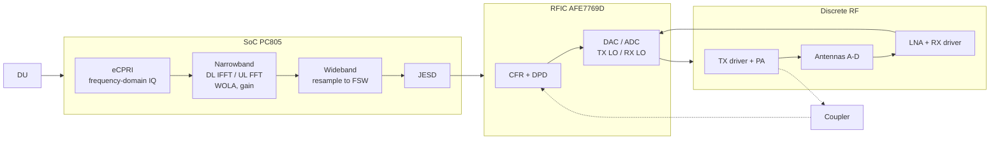
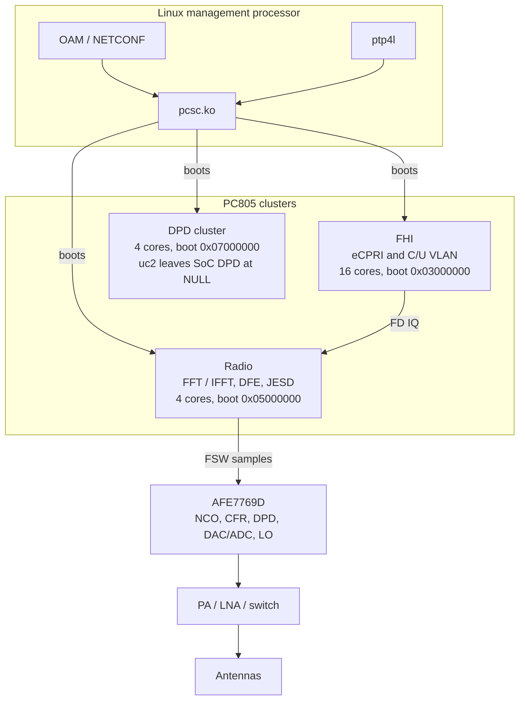
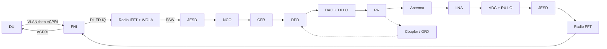
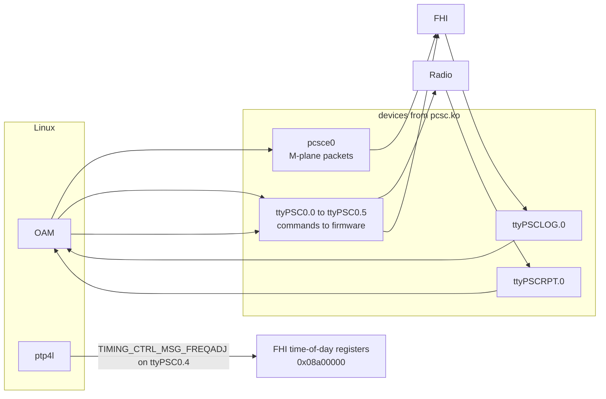
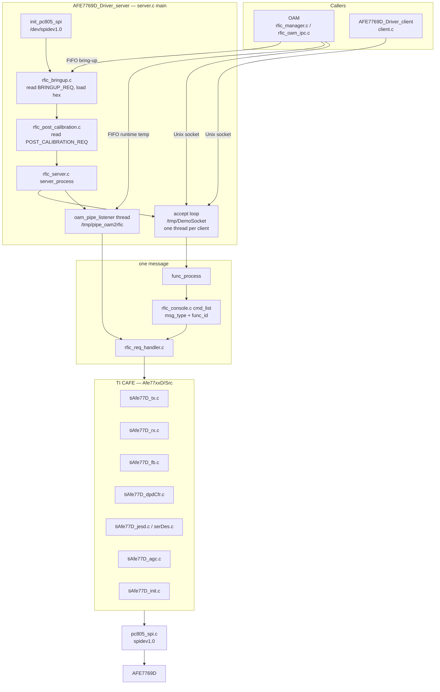

# PC805 RU knowledge

The radio unit is a Picocom PC805 with a TI AFE7769D RFIC. OAM lives in `sources/oam_netconf_2.0.0`. The RFIC driver lives in `sources/rfic_afe7769d-1.6`. Runtime config lives under `packages/oru-8.0.1/firmware/mp_sw/rfic_driver/` and on the board at `/opt/o-ran/sw/sw-0/firmware/mp_sw/rfic_driver/`.

## Quick view

Three blocks share the user-plane path. OAM only configures them.

| Block | Role |
| --- | --- |
| SoC PC805 | Digital side. eCPRI in, FFT/IFFT, gain, resample to FSW, JESD out. Also drives TDD GPIOs for the PA and LNA. |
| RFIC AFE7769D | Bridge from digital samples to RF. CFR, DPD, DAC/ADC, up/down conversion. Two feedback ADCs watch the PA for DPD and IQMC. |
| Discrete RF | Amplify and switch. TX driver, PA, LNA, antenna switch. |

FSW is the wideband IQ sample rate on the JESD link between the SoC and the RFIC, in kHz. OAM computes `fft_length × SCS_kHz × (numerator / denominator)`. uc2 is `4096 × 30 × 1 = 122880` kHz (122.88 MHz). Allowed rates: 30.72, 61.44, 122.88, 245.76, 491.52 MHz.



Downlink is the top path through that diagram: DU to eCPRI to IFFT to FSW to JESD to CFR/DPD to DAC to PA to antenna. The dotted coupler path returns to DPD and does not radiate. Uplink is antenna to LNA to ADC to JESD to FFT to eCPRI to DU. In uc2, CFR and DPD on the SoC wideband chain stay at state NULL. Those blocks run inside the RFIC.

### Where each piece runs

Linux on the management processor does not carry user IQ. `pcsc.ko` (`sources/pcsc_driver-8.0.1`) boots the three clusters, then stays as the pipe between Linux and those clusters.



### User-plane data flow

IQ stays inside the clusters and the RFIC. The dotted arrow is the PA observation path used by DPD and IQMC.



### Control path versus IQ path

OAM configuration and PTP use the devices `pcsc.ko` creates. They never enter the JESD/RFIC IQ stream.



C/U-plane VLAN is stripped inside the FHI cluster before eCPRI IQ is used. M-plane VLAN is a Linux interface `eth.<vlan_id>` on top of `pcsce0`, created by `interface_mgmt.c`.

## pcsc.ko

Source: `sources/pcsc_driver-8.0.1`. Module name `pcsc`, description "Picocom PC805 M-processor Driver". Load with `insmod pcsc.ko` or `insmod pcsc.ko mask=0x111`.

`pcxx_module.c` does four things, in order:

1. Read firmware `pico/pc805.img` and copy it into chip RAM.
2. Start cluster core 0 from the cluster-manager registers. Core 0 then releases the other cores in that cluster.
   - `mask` bit `0x1`: FHI core 0 at `0x03000000` (16 cores).
   - `mask` bit `0x10`: radio core 0 at `0x05000000` (4 cores).
   - `mask` bit `0x100`: DPD core 0 at `0x07000000` (4 cores).
   - Default `0x111` starts all three.
3. Open a shared-memory window at `0x90000000` and create the Linux devices that sit on it:
   - `pcsce0`: Ethernet. NETCONF and PTP packets from Linux enter the FHI through this netdev.
   - `ttyPSC0.0` through `ttyPSC0.5`: six message channels. OAM sends DFE, carrier, and JESD commands to the firmware here.
   - `ttyPSCLOG.0`: firmware logs.
   - `ttyPSCRPT.0`: firmware reports and faults.
4. Map the FHI time-of-day block at `0x08a00000`. When `ptp4l` adjusts the clock, the driver writes `TIMING_CTRL_MSG_FREQADJ` into `ttyPSC0.4` and the FHI cluster applies the frequency correction.

After that the module only forwards packets, messages, logs, and clock adjustments. User IQ runs inside the FHI, radio, and DPD clusters and does not pass through Linux.

## Role of the RFIC in the RU

The RFIC sits between the digital SoC and the antenna. The AFE7769D does the number-to-RF conversion. OAM does not carry user-plane IQ through the RFIC. OAM configures and supervises it.

- Downlink: time-domain IQ from the DFE enters the RFIC over JESD. The RFIC runs CFR and DPD, converts to analog, and upconverts to the TX LO. The discrete RF path then drives the PA and the antenna.
- Uplink: the antenna signal comes through the LNA into the RFIC. The RFIC downconverts from the RX LO, converts to digital, and sends samples back to the DFE over JESD.
- Feedback: two observation receivers sample the signal after the PA so DPD can track PA distortion and so IQ/LO correction can run.

OAM uses the RFIC in two phases:

- At startup it sends LO frequency, bandwidth, TDD or FDD, which antennas are on, and the JESD lane rate. The RFIC loads that configuration and calibrates. The RU is not ready to transmit if this fails.
- While running, OAM sets DSA gain, enables or disables DPD and CFR, reads power and PLL status, and updates the TX DSA versus PA temperature LUT.

## Data path

IQ enters the SoC on eCPRI, crosses to the AFE7769D on JESD, then goes through the discrete RF (driver, PA, LNA, switches) to four antennas A–D. Antenna pairs are AB and CD. Numbers below are the `pc805/uc2` use case under `sources/oam_netconf_2.0.0/usecases/pc805/uc2/` unless a range is given. Structs are in `sources/oam_netconf_2.0.0/local/oam_api/cpri/oru_oam_api.h` and `local/oam_api/rfic_oam_api.h`.

In uc2 the SoC wideband CFR and DPD engines are left at state NULL (`cfr_state` 0, `DPD_state` 0 on DL wideband `chain_idx` 256). CFR and DPD that run are inside the AFE7769D. The SoC still has the wideband-DL-only fields `dfe_config_cfr_t` and `dfe_config_dpd_t`.

`chain_idx` packs direction in the high byte and the chain number in the low byte. Direction 0 is UL, 1 is DL. Wideband indexes are 0–15. Narrowband indexes are 16–255. uc2:

| Chain | chain_idx | Direction | Index |
| --- | --- | --- | --- |
| UL wideband | 0 | 0 | 0 |
| DL wideband | 256 | 1 | 0 |
| UL narrowband | 16 | 0 | 16 |
| DL narrowband | 272 | 1 | 16 |

FFT is the UL narrowband (`fft_mode` 0). IFFT is the DL narrowband (`fft_mode` 1).

### Downlink

```text
DU
  -> SFP / eCPRI (frequency-domain IQ, per eAxC)
  -> SoC PC805, narrowband DL
       gain (fixed_point_gain_real)
       IFFT 4096 + carrier phase compensation (38.211)
       WOLA
       filter bank
       resampling (N/M) to FSW
  -> SoC, wideband DL (carrier combine, wbchain_ctrl)
  -> JESD TX (4.9G / 9.8G / 19.66G)
  -> RFIC AFE7769D, 4 TX channels
       CFR
       DPD
       DAC
       upconvert to TX LO
  -> RF
       TX driver (GPIO D2S, pair AB / CD)
       PA (GPIO PAEN)
       antenna switch
  -> antennas A B C D
```

A coupled sample after the PA returns to the RFIC. That path does not radiate. DPD uses it to learn PA distortion:

```text
coupler after PA
  -> ORX antenna select (ORX1: A or B, ORX2: C or D)
  -> RFIC feedback ADC (2 ORX channels)
  -> DPD loop inside the AFE7769D
```

### Uplink

```text
antennas A B C D
  -> antenna switch
  -> LNA (GPIO PD_LNA; bypass is BP_LNA)
  -> RX driver (GPIO S2D, pair AB / CD)
  -> RFIC AFE7769D, 4 RX channels
       downconvert from RX LO
       ADC
       DDC to FSW
  -> JESD RX
  -> SoC PC805, wideband UL then narrowband UL
       resampling
       filter bank
       WOLA
       FFT 4096 + phase compensation
       gain
  -> eAxC / eCPRI
  -> SFP
  -> DU
```

### Hop parameters

**1. Fronthaul, `du_config_req`.** uc2 uses VLAN C/U transport (`transport_session_type` 0), VLAN 96, PCP 7, L2 MTU 1500. eCPRI compression fields: `is_static_compress` 0 (dynamic), `compress_method` 1 (block floating point), `compress_iq_width` 9, `c_plane_enable` 1, `ul_padding_enable` 1, `eAxC_id_bit_alloc` 0 (bit widths 2 / 6 / 4 / 4). Time windows are nanoseconds: `t2a_min_cp_dl`, `t2a_max_cp_dl`, `t2a_min_up`, `t2a_max_up`, `tcp_adv_dl`, `t2a_min_cp_ul`, `t2a_max_cp_ul`, `ta3_min`, `ta3_max`. Ethernet rate is `ecpri_link_params.eth_link_type` in `ru_init_req` (0 = 25G, 1 = 10G, 2 = 25G RSFEC).

**2. Carrier binding, `carrier_config_req`.** This message ties one carrier to one DU, one DFE profile, one DL narrowband, one UL narrowband, and one TX/RX RF chain.

| Field | uc2 | Meaning |
| --- | --- | --- |
| `carrier_type` / `carrier_index` / `du_index` | 1 / 0 / 0 | Carrier identity and which DU |
| `dfe_profile_index` | 0 | DFE profile |
| `dl_dfe_nbchain_index` / `ul_dfe_nbchain_index` | 16 / 16 | Narrowband index (direction is separate) |
| `dl_re_offset` / `ul_re_offset` | 0 / 0 | RE offset from the bottom of the FD buffer |
| `tx_rfchain_index` / `rx_rfchain_index` | 0 / 0 | RF chain |
| `bandwidth` | 100000 | kHz |
| `scs_hz` | 30000 | Hz. Allowed 15000, 30000, 60000, 120000, 240000 |
| `cp_type` | 0 | 0 normal, 1 extended |
| `num_tx_port` / `num_rx_port` | 4 / 4 | Antenna ports |
| `dl_frame_start_offset` / `ul_frame_start_offset` | 0 / -13021 | ns, range ±10 ms |
| `dl_wave_delay` / `ul_wave_delay` | 5685 / 1026 | ns |
| `sfn_offset` | 0 | units of 10 ms |
| `ul_fft_dynamic_scaling_enable` | 0 | UL FFT dynamic scaling |
| `slotnum_txrx_pattern` | 10 | 0 means FDD. 1–80 means TDD |
| `slotconfig[]` | 10 words | 14-symbol TX/RX pattern per slot in the TDD period |

eAxC (`ecpri_eaxc_params`): `du_port_id`, `bandsector_id`, `cc_id`, then per antenna `ru_port_dl[]`, `ru_port_ul_nonprach[]`, `ru_port_ul_prach[]`. uc2 maps antennas 0–3 to RU ports 0–3 on DL, UL, and PRACH.

Runtime digital gain after this message: `dl_gain_update_req.dl_amplitude_scale` (uc2 carrier 0 = 1024) and `ul_scale_update_req.scale` (uc2 = 0).

**3. SoC DFE, `dfe_config_req`.** One profile (`dfe_profile_idx` 0) with `wb_num` 2 and `nb_num` 2. `wbchain_ctrl` / `nbchain_ctrl` 15 enables DFE channels 0–3 (bitmap).

DL narrowband (`chain_idx` 272) and UL narrowband (`chain_idx` 16), uc2:

| Block | Parameter | uc2 |
| --- | --- | --- |
| FFT / IFFT | `fft_mode` | DL 1 (IFFT), UL 0 (FFT) |
| | `fft_length` | 4096 |
| | `nr_numerology` | 1 (30 kHz). 0=15, 1=30, 2=60, 3=120, 4=240 |
| | `carrier_freq` | 3522180 kHz (`freq_scale` 6 means the unit is kHz) |
| | `phase_compensation_enable` | 1 (38.211 5.4) |
| | `cp_and_rat_type` | 1 (NR). Bit0 RAT, bit1 CP |
| | `fft_input_scale_fixed_point` / `fft_output_scale_fixed_point` | 0. 0xFFFF means no scaling |
| | `cp_length` / `symbol_length` | 65535 means ignored by RU SW |
| WOLA | `wola_enabled`, window, shift, type | 1, 116 samples, 58 samples, type 0 rectangular |
| Gain | `fixed_point_gain_real` / `imag` | DL 1024 / 0. UL 0 / 0. This real part is `dl_amplitude_scale` |
| Filter bank | `num_filter_bank_params` | 0 (bypass) |
| Resampler | `numerator` / `denominator` | 1 / 1 |

FSW in kHz is `fft_length * scs_kHz * (numerator / denominator)`. uc2: 4096 * 30 * 1 = 122880. Legal FSW values are 30720, 61440, 122880, 245760, 491520.

Wideband DL CFR/DPD (`chain_idx` 256) can be scheduled by SFN and slot. State 0 NULL, 1 reset, 2 init, 3 run, 4 pause, 5 train. uc2 leaves both at 0. `cfr_threshold` and `cfr_time_offset` / `dpd_time_offset` are sample-domain and unused while state is NULL.

Low-PHY extras in `ru_sw_config_req.low_phy_params`: `stop_radio_when_unsync` 1, `smart_dl_gain_enable` 0, `sss_amplitude_fd` 1024 (used only when smart DL gain is on: SSS dBFS = 20*log10(value/32767)), `unified_ca_power` 1.

**4. JESD between SoC and RFIC, `ru_sw_config_req.jesd_lane_params`.** `jesd_lane_rate` 2 = 9.8G. 0 = 2.5G (not configurable on bring-up), 1 = 4.9G, 3 = 19.66G (PC805 only). OAM stores this rate and copies it into `rfic_bringup_req.jesd_lane_rate`. `update_phy_config` 0 leaves the SERDES PHY at its default. When set to 1, `phy_config` applies TX invert, vboost, iboost, and 3-tap EQ, and RX VGA, CTLE, DFE tap, attenuation, AFE rate, and adapt mode.

After the hex image loads, bring-up calls `setGoodRbd` on every DAC JESD link (RBD check, good-RBD range, manual RBD, ADC/DAC sync).

**5. RF chain to RFIC LO and IBW, `rf_config_req`.** uc2 has one TX chain and one RX chain. `rf_chain_ctrl` 15 enables antennas 0–3. `bandwidth` 12 means 100 MHz (enum: 0=1.4, 1=3, 2=5, 3=10, 4=15, 5=20, 6=25, 7=40, 8=50, 9=60, 10=70, 11=90, 12=100, 13=200, 14=400, 16=30, 17=80). `carrier_freq` 3522180 is kHz when `freq_scale` is 6. `subcarrier_spacing` 1 is 30 kHz. `cyclic_prefix` 0 is normal. `band_type` 0 is NR. `nominal_rms_out_power` and `nominal_rms_input_power` 32767 (0x7FFF) mean "invalid / unused". TX `gain` is documented as `dl_amplitude_scale` but bring-up takes the scale from the DFE gain block, not from this field. RX `gain` 32767 is unused.

`fill_rfic_bringup_req` builds `rfic_bringup_req_t` from these messages:

| RFIC field | Source |
| --- | --- |
| `board_type` | OAM board type |
| `jesd_lane_rate` | saved from `ru_sw_config_req` |
| `band_num` | 1 |
| `tx_ant_alloc` / `rx_ant_alloc` | `rf_chain_ctrl` of TX chain 0 / RX chain 0 |
| `tx_lo_freq` / `rx_lo_freq` | `carrier_freq` of those chains, kHz |
| `tx_ibw` / `rx_ibw` | bandwidth enum converted to kHz |
| `duplexing` | 0 TDD if `slotnum_txrx_pattern` != 0, else 1 FDD |
| `carriers[].bandwidth` | `common_params.bandwidth`, kHz |
| `carriers[].scs` | SCS index from `scs_hz` (0=15 kHz …) |
| `carriers[].freq_offset` | DFE DL `carrier_freq` minus `tx_lo_freq`, kHz |
| `carriers[].dl_amplitude_scale` | DFE DL `fixed_point_gain_real` for `dl_dfe_nbchain_index` |
| `fsw` | formula above, from the first carrier's SCS |

uc2 result: LO 3522180 kHz TX and RX, IBW 100000 kHz, duplex TDD, one carrier, freq offset 0, amplitude scale 1024, FSW 122880.

**6. RFIC image and `RFIC_Config.ini`.** Bring-up loads a hex selected by board, FSW, JESD rate, CFR/DPD, and FDD vs TDD. The Gigalane default in the INI is `Custom_Hex_File_Path` (uc2 example name encodes fsw 122.88, 9.8G, CFR/DPD). On a Picocom RDB the driver picks the hex itself. INI path: `/opt/o-ran/sw/sw-0/firmware/mp_sw/rfic_driver/RFIC_Config.ini`. LUT path: `RFIC_Config_LUT.csv` next to it.

Antenna-to-channel maps are hardware wiring, indexed by antenna: `Tx_Ant_To_Ch_Map=[0,1,3,2]`, `Rx_Ant_To_Ch_Map=[1,0,2,3]`. Every later per-channel write goes through this map.

| INI key | uc2 example | Unit |
| --- | --- | --- |
| `Log_Level` | 2 | 0 error … 4 debug |
| `Override_Tdd` | 0 | 0 = pins control TDD. 1 = force TX/RX/FB from the override mask |
| `SPI_speed` | 3000000 | Hz |
| `Tx_Dsa` | 72, 68, 52, 44 | per antenna, applied on the mapped channel |
| `Rx_Dsa` | 45 each | 0–56 = 0–28 dB, step 0.5 dB |
| `Fb_Dsa` | 14, 2 | 0–32 = 0–16 dB, step 0.5 dB, even values only |
| `Tx_Fb_Mux_Inverse` | 0, 1 | FB mux GPIO polarity per FB channel |
| `Measure_Delay_Flag` | 1 | 1 measures IQMC and DPD loop delay. 0 writes `Iqmc_Delay` and `Dpd_Delay` as-is |
| `Iqmc_Lol_Flag` | 1 | run TX IQMC and LO-leakage steady state |
| `Iqmc_Delay` | per channel | external TX IQMC loop delay |
| `Dpd_Delay` | per channel | DPD loopback delay |
| `Dpd_Trigger` | 1 | freeze, optional enhance feature, then `dpdTrigger` |
| `Dpd_Model` | 4044 x4 | model index per antenna |
| `Dpd_Est_Gain` | per antenna | DPD estimator input gain |
| `Dpd_Corr_Gain` | 900 | 0–1000 = 0 to -10 dB, step 0.01 dB |
| `Cfr_Gain` | 890 | 0–1500 = 0 to 15 dB, step 0.01 dB |
| `Cfr_Peak_Limit` | -81 | -140–0 = -14–0 dB, step 0.1 dB. 0 means leave the hex value |
| `Cfr_Peak_Det_Win_Len` | 2 | 0–65 = 0–650 ns, step 10 ns. 0 means derive `200 / min_bandwidth` |
| `Cfr_Peak_Min_Separation` | 2 | same range. Raised to the window length if smaller |
| `Cfr_Relative_Power` | 0 | per carrier, -100–100 = -10–10 dB. Highest-PSD carrier is 0 dB |
| `Tx_Gain_Control_Enable_Mask` | 0xF | antenna bitmask for CLGC |
| `Min_Tx_Dsa` / `Max_Tx_Dsa` | 0 / 300 | -24–312 = -3–39 dB, step 0.125 dB |
| `BoardTemp` | 76 | Celsius at the point where `Dpd_Est_Gain` was taken |
| `DpdEstimInGainUpdateMode_Flag` | 1 | 0 direct estim gain. 1 temperature-LUT mode |
| `EnableDpdOutEqlzrFilt` | 1 | apply the measured DPD output equalizer |
| `EnhanceFeature1` | 1 | DPD performance-enhance feature before trigger |

CFR carrier count, bandwidth select, SCS, center frequency, and relative power are filled from the carrier set (`cfr_num_carrier`, `cfr_bandwidth_sel`, `cfr_subcarrier_spacing`, `cfr_center_freq`). Bandwidth select matches `cfr_bandwidth_sel_e` in `rfic_config.h` (0 = 5 MHz … up to 100 MHz).

**7. Discrete RF and TDD, `carrier_config_req.tdd_switching_params`.** Each GPIO array is one entry per antenna. 0xFF means that antenna has no pin. uc2 shares one pin across a pair: antenna 0 uses the AB GPIO, antenna 1 uses the CD GPIO, antennas 2 and 3 are 0xFF. Polarity 1 is active-high, 0 is active-low. uc2: RFIC TX/RX, TRX switch, and PA are active-high. LNA, LNA bypass, TX driver, and RX driver are active-low.

Pad times are nanoseconds, range 0–30000, and are applied only when `update_tdd_padding_time` is 1. uc2 turns that on. TX-side pads (RFIC TX, TRX, PA, TX driver) use a shorter on-pad (about 5–7.7 µs). RX-side pads (RFIC RX, LNA, LNA bypass, RX driver) use 12700 ns on and 2000 ns off.

| Array | uc2 GPIO | Signal |
| --- | --- | --- |
| `gpio_rfic_tx_en` | 0, 1, 4, 5 | AFE TX enable. Entries 2–3 in this JSON are 4 and 5, which are the ORX-enable pins in `pc805_rdb.h` |
| `gpio_rfic_rx_en` | 2, 3, 255, 255 | AFE RX enable AB / CD |
| `gpio_trx_switch` | 19, 20, 255, 255 | LNA / antenna switch (`SWCTRL_LNA`) |
| `gpio_pa_en` | 15, 16 | PA enable |
| `gpio_lna_en` | 13, 14 | LNA power-down / enable |
| `gpio_lna_bp` | 11, 12 | LNA bypass |
| `gpio_tx_driver_en` | 7, 8 | TX driver (`PD_D2S`) |
| `gpio_rx_driver_en` | 9, 10 | RX driver (`PD_S2D`) |

Fixed GPIO ids in `local/platform/pc805_rdb/pc805_rdb.h`: TX_EN 0/1, RX_EN 2/3, ORX_EN 4/5, D2S 7/8, S2D 9/10, LNA bypass 11/12, LNA 13/14, PA 15/16, ORX1 select 17 (A vs B), ORX2 select 18 (C vs D), LNA switch 19/20.

The SoC processes IQ and streams samples over JESD. The RFIC converts between digital and analog and translates frequency. The discrete RF amplifies and switches TDD. OAM drives those GPIOs from the slot pattern: TX enable and PA while transmitting, RX enable and LNA while receiving, ORX enable while DPD captures feedback.

## DL correction inside the RFIC

Calibration is the startup measurement that loads coefficients into the correction blocks. After that, those blocks correct every IQ sample on their own. Downlink order inside the AFE7769D:

```text
JESD (samples at FSW)
  -> NCO
  -> CFR
  -> DPD
  -> DAC
  -> mix with LO
  -> PA
  -> antenna
       coupler returns to the feedback ADC, into DPD and IQMC
```

| Block | What it does | Where the number comes from |
| --- | --- | --- |
| NCO | Digital frequency shift. Offset is `freq_offset` = carrier frequency minus TX LO, kHz. uc2 offset is 0, so the carrier sits on the LO. | `rfic_bringup_req` carrier `freq_offset` |
| LO | Analog local oscillator. The mixer multiplies the DAC output by the LO to reach the air frequency. | `tx_lo_freq`, uc2 3522180 kHz |
| CFR | Clips OFDM peaks before the PA so the PA does not saturate. | `Cfr_Peak_Limit`, `Cfr_Gain` |
| DPD | Pre-distorts the waveform with the inverse of the PA. The coupler sample after the PA keeps the radiated signal linear. | `Dpd_Model`, `Dpd_Delay`, `Dpd_Est_Gain`, `Dpd_Corr_Gain` |

NCO and LO place the carrier. CFR and DPD shape the waveform. Calibration (`RFIC_POST_CALIBRATION_REQ`, reported by OAM as antenna calibration) runs once at startup, after the LO is already set:

1. Transmit through the PA and measure the IQMC and DPD loop delays, so the feedback sample lines up with the transmitted sample.
2. Run IQMC and LO-leakage cancellation to steady state. This corrects I/Q imbalance and carrier leak through the mixer.
3. Load CFR and the DPD model, then `dpdTrigger` so DPD starts learning the PA.
4. Enable CLGC so TX gain does not drift with PA temperature.

## Calibration

OAM starts the driver, waits for bring-up, then calls `calibrate_rfic()` (`rfic_manager.c`). That sends empty `RFIC_POST_CALIBRATION_REQ` (16) and waits up to 240 s. Success sets health `AFE7769D_Driver` true. Failure sets it false and is the antenna-calibration fault. The driver side is `rfic_bringup()` then `rfic_post_calibration()` → `handle_rfic_config_ini()` in `rfic_post_calibration.c`.

Bring-up, before any DL/UL trim:

1. Receive `RFIC_BRINGUP_REQ` and keep the band, LO, FSW, duplex, and JESD rate.
2. Load the hex with `afeDeviceBringup`.
3. `setOverrideTdd`: 0 when `Override_Tdd` is 0 (pins own TDD), or mask `0xBEF` when override is on.
4. `setGoodRbd` on each JESD DAC link.
5. Check device health and that the LO set is legal for the PLL mux mode.
6. Enable the on-chip temperature sensor.

### DL method

DL calibration is the external-loopback characterization plus IQMC, LO leakage, CFR, DPD, and CLGC. The observation path is the coupler after the PA into the two FB ADCs. `Tx_Ant_To_Ch_Map` selects the AFE channel for each antenna.

1. FB mux polarity. `Tx_Fb_Mux_Inverse` calls `setGpioFuncPolarity` on FB mux 0 and mux 3.
2. RX DSA is written here too (`setRxDsaAttn`) so the chip is in a known gain state before LO change. See UL.
3. LO. `update_lo` writes `rx_lo_freq` and `tx_lo_freq` through the antenna map into channel pairs (RX12, RX34, TX12, TX34). On 2T2R, channel pair 34 must use the same LO as pair 12. If the new LO differs from the hex, `dynamicLoChangeWrapper` retunes and carries the current IQMC and DPD delays across.
4. Loop delay. If `Measure_Delay_Flag` is 0, write `Tx_Dsa`, `Fb_Dsa`, `Iqmc_Delay`, and `Dpd_Delay` from the INI. If it is 1, `measure_iqmc_and_dpd_delaychar` runs:
   - Set TX DSA and the default analog/digital TX DSA, and set FB DSA.
   - Per TX channel, `externalLoopBackDelayCharAndEqlzrCoeffEstChar` with `powerVal` 30. It returns IQMC delay, DPD delay, and a 16-tap DPD-output equalizer (normalized band about ±0.45, 50 MHz).
   - A delay is accepted only when its validity flag is 1. Otherwise post-calibration fails.
   - Program `set_txIqmcExternalDelayValue` and `set_dpd_dpdLoopbackDelayValue`.
   - If the equalizer is valid and `EnableDpdOutEqlzrFilt` is 1, `configDpdOutEqlzrFilt` loads it.
   - Valid delays are written back to `Iqmc_Delay` and `Dpd_Delay` in the INI through `AFE7769D_Driver_client`.
5. Apply delays. `config_iqmc_and_dpd_delay` reads them back and calls `configureDpdDelayVal` per channel and `configureTxIqmcLolDelayVal` for all four channels. Unused channels still need a non-zero delay.
6. CFR. Per TX channel: carrier count, optional peak limit, peak-detect window, minimum peak separation, and per carrier the bandwidth select, SCS, relative power, and center frequency. Then one `cfrConfig`. If `Dpd_Trigger` is 0 the CFR mode is forced off.
7. Gains. `updateDpdEstimIpGain` from `Dpd_Est_Gain`, `updateDpdCorrOpGain` from `Dpd_Corr_Gain`, `updateCfrOpGain` from `Cfr_Gain`.
8. IQMC and LO leakage. If `Iqmc_Lol_Flag` is 1, `txIqmcLolSteadyState` runs the correction to steady state. Convergence is readable later with `RFIC_CMD_READ_STATUS_GET_TX_IQMC_LOL_CONVERGENCE_STATUS`.
9. CLGC, when `Tx_Gain_Control_Enable_Mask` is non-zero. The mask is translated from antenna bits to channel bits. `clgc_txDsaRange` sets `Min_Tx_Dsa` and `Max_Tx_Dsa`, then `txDsaControlMode(..., 1)` selects closed-loop gain control. The CSV LUT (`tempIndex`, measured PA, desired PA, 0.01 dB) is turned into a DPD-estimator-gain versus temperature table by `computeDpdEstimInGainVsTempLut` using `BoardTemp` and `Dpd_Est_Gain`, then `updateDpdEstimInGainVsTempLut`. If `DpdEstimInGainUpdateMode_Flag` is 1, temperature update mode and LUT-based estim-gain update are enabled on all four channels (`0xf`).
10. DPD model and trigger. `dpdModelSwitch` loads `Dpd_Model` per antenna. If `Dpd_Trigger` is 1: `dpdFreeze(0xf, 1)`, `updateDpdPerfEnhanceFeature1State` from `EnhanceFeature1`, then `dpdTrigger`.

After this, PA temperature updates (`rfic_temperature_update_req_t`) keep the TX DSA LUT aligned. `txChSel` is a channel bitmask (`0x01` TX1 … `0x0F` all) and `pa_temp` is Celsius.

### UL method

There is no UL loopback-delay or DPD procedure in this driver. Uplink level and frequency are set as part of the same post-calibration, and the ADC/DDC/AGC defaults come from the hex loaded at bring-up.

1. Image. `afeDeviceBringup` loads the RX converter, DDC, and any RX calibration stored in the hex for this FSW and JESD rate.
2. RX attenuation. `setRxDsaAttn` writes `Rx_Dsa` on the channel from `Rx_Ant_To_Ch_Map`. Range 0–56 is 0–28 dB in 0.5 dB steps. This is the UL RF gain trim.
3. RX LO. The same `dynamicLoChangeWrapper` call that retunes TX also programs `rx12Lo` and `rx34Lo` from `rx_lo_freq`. uc2 uses one LO, 3522180 kHz, on TX and RX.
4. SoC UL scale, separate from the RFIC. `ul_fft_dynamic_scaling_enable` in the carrier message, FFT input and output scales on the UL narrowband, `fixed_point_gain_real` on that chain (0 in uc2), and `ul_scale_update_req.scale` (0 in uc2). `ul_frame_start_offset`, `ul_wave_delay`, and `ul_re_offset` align the UL symbol in time and in the FD buffer. They are timing parameters, not gain calibration.
5. Runtime RX DC. `RFIC_CMD_SET_RX_DC_BW` / `setRxDcBw` sets the RX DC filter bandwidth per channel after calibration. It is not called from `handle_rfic_config_ini`.

A failed post-calibration aborts before DPD trigger and is reported to OAM as the antenna-calibration failure. Re-running delay measurement or IQMC steady state later is the EXEC commands `RFIC_CMD_EXEC_MEASURE_IQMC_AND_DPD_DELAYCHAR`, `RFIC_CMD_EXEC_CONFIG_IQMC_AND_DPD_DELAY`, and `RFIC_CMD_EXEC_TX_IQMC_LOL_STEADY_STATE`.

## RFIC channels and rates

- 4 TX, 4 RX, 2 feedback. Antenna use is a bitmap in `tx_ant_alloc` / `rx_ant_alloc` (bit 0 = antenna 0).
- FSW is kHz: 30720, 61440, 122880, 245760, 491520. OAM derives it as `fft_length * scs_khz * (numerator / denominator)` from the DFE JSON profile.
- Duplex: 0 = TDD, 1 = FDD. JESD lane rate on bring-up: 1 = 4.9G, 2 = 9.8G, 3 = 19.66G (PC805 only). 2.5G is not configurable.
- Frequencies, IBW, and bandwidth are kHz. `dl_amplitude_scale` comes from DFE `fixedPointGainReal`.

Two processes talk to the chip: the driver (`AFE7769D_Driver` / `AFE7769D_Driver_server`) and OAM.

## RFIC software architecture

Built from `sources/rfic_afe7769d-1.6/AFECLibs/CAFE`. Two binaries from `Makefile`: `AFE7769D_Driver_server` (`server.c`) and `AFE7769D_Driver_client` (`client.c`). Both link the same Picocom glue and the TI CAFE library.



`server.c` `main` runs once, in this order: change to the binary directory, open the two FIFOs, read `RFIC_Config.ini`, open SPI, `rfic_bringup`, reply on `/tmp/pipe_rfic2oam`, then in normal mode `rfic_post_calibration` and reply again, then block in `server_process`. Argument `serdes` skips post-calibration.

Inside `server_process` (`rfic_server.c`) two paths share one `g_afe_lock`:

- The listener thread `oam_pipe_listener` polls `/tmp/pipe_oam2rfic` and calls `oam_msg_handle_any` (`rfic_oam_msg_handle.c`). This is how a later PA-temperature update arrives.
- Each accepted client on `/tmp/DemoSocket` gets a detached thread. The thread reads a `rfic_general_msg_t`, calls `func_process`, and writes the same buffer back. `func_process` calls `handle_request`.

`handle_request` looks up `cmd_list` in `rfic_console.c`. The row is `msg_type` (READ_STATUS, GET, SET, LOAD, SAVE, EXEC, SERDES, CLI). The column is `func_id` from `rfic_msg.h`. Each entry has three functions: `rfic_req_handler.c` talks to the chip, `rfic_cmd_handler.c` parses the CLI text, `rfic_resp_handler.c` prints the reply. The server uses the req handler.

The req handler calls `AFE77DFNP(...)`, which is the TI prefix `ti_afe77D_`. Those functions live in `Afe77xxD/Src` and only touch the chip through the SPI hooks in `pc805_spi.c` (`/dev/spidev1.0`, speed from `SPI_speed` in the INI). Register read and write do not go through JESD. JESD itself is the IQ datapath between the SoC radio cluster and the AFE; this software only configures it.

| Source | Layer |
| --- | --- |
| `server.c`, `client.c` | Process entry |
| `rfic_bringup.c`, `rfic_post_calibration.c`, `rfic_config.c` | Startup and INI |
| `rfic_server.c`, `rfic_oam_msg_handle.c` | FIFO and socket threads |
| `rfic_console.c`, `rfic_msg.h` | Command table |
| `rfic_req_handler.c` | Server command implementation |
| `Afe77xxD/Src/tiAfe77D_*.c` | TI device API: tx, rx, fb, jesd, serdes, dpdCfr, agc, pap, vswr, init |
| `pc805_spi.c` | SPI to the chip |

## Two control paths

Do not mix them. Message layouts must stay identical on both sides.

1. Bring-up FIFO (`sources/oam_netconf_2.0.0/local/components/rfic_manager.c` and `rfic_oam_msg_handle.c`).
   - OAM writes `/tmp/pipe_oam2rfic`, driver replies on `/tmp/pipe_rfic2oam`.
   - OAM message type `OAM_MESSAGE_TYPE_PICO_RFIC`, `msg_num` must be 1.
   - `RFIC_BRINGUP_REQ` (15) carries `rfic_bringup_req_t`. `RFIC_POST_CALIBRATION_REQ` (16) is empty. Wait timeout is 240 s.
   - Order: bring-up, then post-calibration. LED events bracket both. Health name is `AFE7769D_Driver`.
   - API structs are packed and duplicated: `local/oam_api/rfic_oam_api.h` and `rfic_afe7769d-1.6/.../oru_oam_api/rfic_oam_api.h`. Change both.

2. Runtime Unix socket (`rfic_oam_ipc.h` / `rfic_client.c`).
   - Socket `/tmp/DemoSocket`. Body is `uint32_t param_num` plus `int32_t` params. Buffer is 2100 `int32_t`s.
   - Types: READ_STATUS, GET, SET, LOAD, SAVE, EXEC, SERDES, CLI, EXIT. Func IDs are the enums in `rfic_msg.h` (`rfic_cmd_get_e`, `rfic_cmd_set_e`, …).
   - OAM copies of those IDs are in `rfic_oam_ipc.h` under `GIGALANE`. Keep them in lockstep with `rfic_msg.h`.

## Config and LUT

- `RFIC_Config.ini` and `RFIC_Config_LUT.csv` (default paths in `rfic_config.h`). Hex images are selected by use case (FSW, 9.8G, CFR/DPD, FDD vs TDD, Gigalane vs Picocom).
- PA temperature updates (`rfic_temperature_update_req_t`, `rfic_temperature_manager.c`) select TX channels bitwise (`0x01` TX1 … `0x0F` all) and pass Celsius. That drives the TX DSA vs temperature LUT.

## When editing

- Bring-up payload changes belong in both `rfic_oam_api.h` copies and in `rfic_manager.c` plus `rfic_oam_msg_handle.c`.
- CLI/get/set command additions belong in `rfic_msg.h` and the matching OAM enum, then the command handler.
- Build the driver with `./project_start.sh build` (or `./docker_build.sh bash project_start.sh build`) using `riscv32-linux-gcc`. Binary is `AFE7769D_Driver`.
