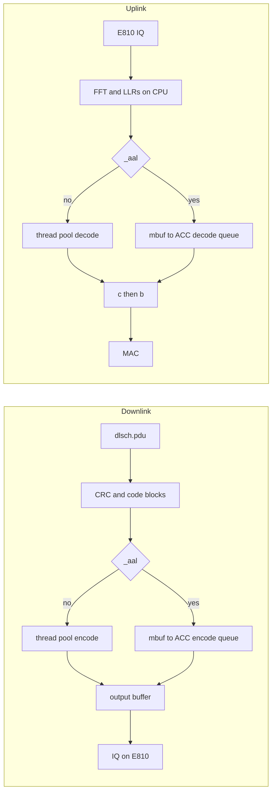

# ACC100 LDPC — accumulated experience

**Author:** LATUAN · **2026.10.20** · `LATUAN_ACC100_LDPC`  
Card is not enabled yet. No measured numbers.

ACC100 encodes and decodes LDPC only. IQ still goes through the E810 at `0000:11:09.0`. OAI uses VF `0d5d`. The PF is `0d5c`. `pf_bb_config` must stay running. `_aal` loads `libldpc_aal.so`. With no key, LDPC stays on the CPU.

## DL and UL versus the CPU

Same call on both paths. `_aal` only changes which library the pointer loads. CRC, segmentation, modulation, FFT, and FHI stay on the CPU.

| | CPU (`libldpc.so`) | ACC (`libldpc_aal.so`) |
|---|---|---|
| DL call | `nr_dlsch_encoding` → `nrLDPC_coding_encoder` | same pointer |
| DL work | Groups of 8 code blocks, `pushTpool` on cores 11–15 and 32–38, then join | One L1 TX thread, `encode_mutex`, one encode queue |
| DL result | Written straight into `output` | Copy to an mbuf, card DMA, copy back into the same `output` |
| After DL | `do_one_dlsch` makes IQ, FHI sends it on the E810 | same |
| UL call | `nr_ulsch_decoding` → `nrLDPC_coding_decoder` | same pointer |
| UL input | LLRs already in `pusch_vars.llr`, one pool task per code block | Those LLRs are scaled and copied into an mbuf |
| UL work | Decode on the thread pool. HARQ buffer `d[r]` stays in host RAM | `decode_mutex`, one decode queue. HARQ stays on the card |
| UL result | Decoded bytes in `harq_process->c[r]`. On CRC success, copied to `harq_process->b` | Card writes the same `c[r]`. The copy to `b` is unchanged |

TM DL runs the encode branch only (`ulsch_slot_bitmap == 0`). E2E runs both. The ACC is faster only when the card plus the two copies beats the thread pool.

## Deploy

Use `systemctl stop/start oai-du` only. `deploy.sh stop` and an `oai-gnb-env` restart can block on hugepages, and a SIGKILL at 10 s leaves the ACC queue stuck.

1. Build with `--build-lib ldpc_aal`. `ldd` must show `/opt/dpdk-22.11.11`.
2. `modprobe vfio-pci enable_sriov=1 disable_idle_d3=1`, bind the PF, run `pf_bb_config` with `acc100_config_1vf_5g.cfg`, set `sriov_numvfs=1`.
3. One UUID, stored in `/var/lib/oai-acc100/`.
4. Two confs only, 100 MHz 4×4 E2E and TM DL: `_aal`, `dpdk_dev` = the VF, `is_t2 = 0`. Leave `dpdk_core_list` unset. Leave the ACC BDF out of `fhi_72.dpdk_devices`.

## Check

Keep ACC as the live path only when all four rows pass. Otherwise restore `nr_softmodem` and `gnb.conf`, and remove `libldpc_aal.so`.

| Step | Pass |
|---|---|
| Card, DU stopped | `dpdk-test-bbdev` passes. On failure, start the old DU. |
| First 60 s | `skipping EAL initialization`, bbdev sees the VF, one encode queue and one decode queue. |
| TM DL, 10 min | No +3 slot jump. MAC drop stays within 5%. |
| E2E | UE attaches. MCS 26 iperf stays within 5% of 950 Mbit/s. Leave iterations at 15 and keep `skip_rx_if_busy`. |

## When it fails

| See | Remember |
|---|---|
| `deploy.sh` stuck | A process still holds hugepages. Wait until `HugePages_Free == HugePages_Total`. |
| DU dies in `nrLDPC_coding_init` | Daemon, UUID, or VF is not on `vfio-pci`. |
| Log says `initializing EAL` | xRAN did not receive the VF. Fix `_aal` and `is_t2 = 0`. |
| Hang ~120 s, then exit | FLR the ACC VF, restart `pf_bb_config`, then start the DU. Leave the PF alone. |
| Throughput drop over 5% | Turn `_aal` off. Leave iterations unchanged for that run. |
| E810 disappears | `oai-gnb-env` was restarted. |
