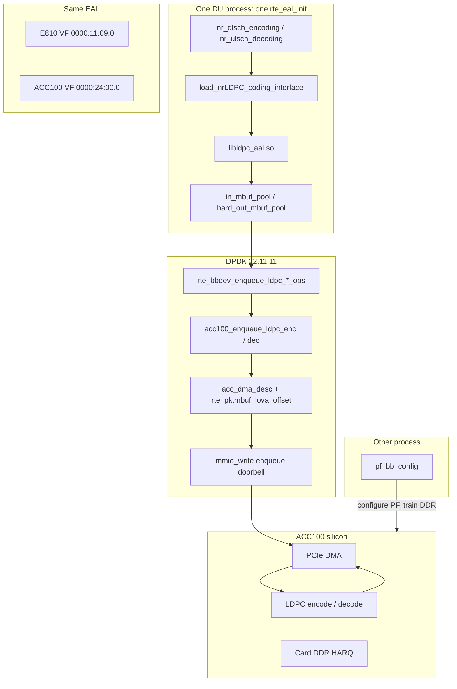
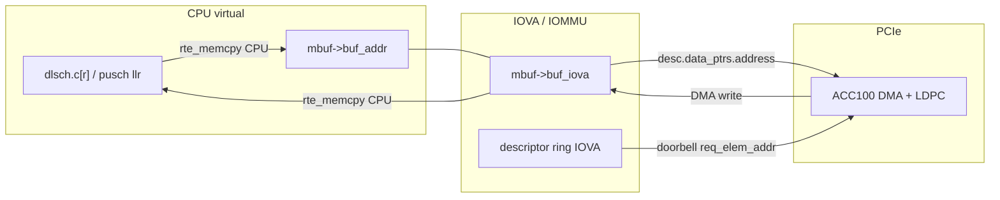
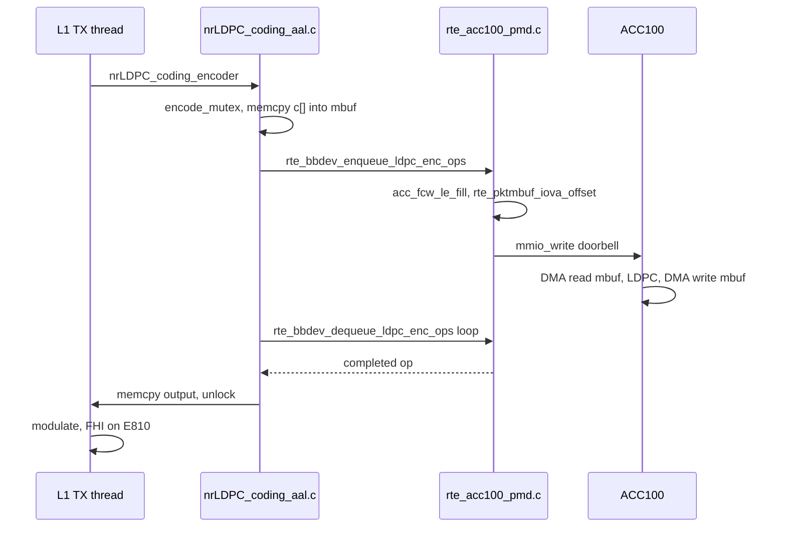

# DMA and Intel ACC100 in this OAI DU

**Author:** LATUAN · **2026.10.25** · `LATUAN_ACC100_LDPC`  
**Trees:** OAI `sources/openairinterface5g-v26.w14`, DPDK `sources/dpdk-v22.11.11`, xRAN F-release `sources/o-du-phy-oran_f_release_v1.9`, `sources/pf-bb-config`.  
**Related:** `docs/LATUAN_E810_eCPRI_DPDK_study.md` (same hugepage pool, E810 eCPRI VF), `docs/LATUAN_DPDK_ACC100_debug_cli.md`, `docs/LATUAN_ACC100_experience.md`, `docs/gNB_256_acc100_design.md`, `docs/LATUAN_ACC100_package_design.md`.

This file is a study of **this checkout**, not a generic DPDK article. Every function name below exists in these trees. The generic claim that “the CPU may do other work while ACC100 runs” is **false on this path**: OAI polls the same queue until the burst completes.

---

## 1. What DMA means here

DMA is the ACC100 reading and writing **host RAM** over PCIe without the CPU copying each LLR or parity bit through MMIO.

Two different memories exist:

| Memory | Who allocates it | Who DMA-accesses it | What it holds |
|---|---|---|---|
| Host hugepage pool (2 MB pages, 8192 pages ≈ 16 GB) | `oai-gnb-env` / DPDK EAL, one pool in the DU process | E810 VF (IQ) and ACC100 VF (LDPC mbufs) | FHI IQ plus one LDPC code block at a time (≤ 32 KB) |
| ACC100 onboard DDR (4096 MB total, `ACC100_HARQ_TOTAL_DDR`) | Card itself, trained by `pf_bb_config` | ACC100 only | UL HARQ soft-combine |

`pf_bb_config` is a **third process**. It `mmap`s the PF BAR and a small anonymous info ring (`MAP_ANONYMOUS`), then `VFIO_IOMMU_MAP_DMA`. Slot payload never goes through it.

A CPU virtual pointer is not a DMA address. The device uses the mbuf **IOVA** (`mbuf->buf_iova`). Hugepages plus VFIO/IOMMU make that IOVA valid. Hugepages alone do not.

---

## 2. Architecture of this platform



ACC100 is FEC only. FFT, channel estimation, MIMO, modulation, resource mapping, and FHI stay on the CPU. ACC100 PMD `num_queues[RTE_BBDEV_OP_FFT] = 0`.

---

## 3. Files to read, in this order

| Layer | File | Role |
|---|---|---|
| Conf | `configs/gnb/002.gnb.sa.e2e.band79.100mhz.273.fhi72.4x4.conf` | `loader.ldpc.shlibversion = "_aal"`, `nrLDPC_coding_aal.dpdk_dev`, `vfio_vf_token`, `is_t2 = 0` |
| FHI publish | `sources/openairinterface5g-v26.w14/radio/fhi_72/oran-config.c` | If `_aal` and `is_t2 == 0`, set `bbdev_dev` and `XRAN_BBDEV_MODE_HW_ON` |
| xRAN EAL | `sources/o-du-phy-oran_f_release_v1.9/fhi_lib/lib/ethernet/ethdi.c` | First `rte_eal_init`: `-a<E810>` and `-a<ACC VF> --vfio-vf-token=` |
| Loader | `.../nrLDPC_coding/nrLDPC_coding_interface_load.c` | Loads `libldpc` + version → `libldpc_aal.so` |
| PHY DL | `.../PHY/NR_TRANSPORT/nr_dlsch_coding.c` | Builds slot parameters, calls `nrLDPC_coding_encoder` |
| PHY UL | `.../PHY/NR_TRANSPORT/nr_ulsch_decoding.c` | Attaches `pusch_vars.llr`, calls `nrLDPC_coding_decoder` |
| Offload | `.../nrLDPC_coding_aal/nrLDPC_coding_aal.c` | Probe, mbuf copy, enqueue, poll, copy back |
| Notes | `.../nrLDPC_coding_aal/README.md` | HARQ internal memory, LLR scaling, TB-mode special case |
| BBDEV API | `sources/dpdk-v22.11.11/lib/bbdev/rte_bbdev.h` | Inline `rte_bbdev_enqueue_ldpc_enc_ops` / `_dec_ops` |
| ACC100 PMD | `sources/dpdk-v22.11.11/drivers/baseband/acc/rte_acc100_pmd.c` | Descriptor fill + `acc_dma_enqueue` |
| DMA helpers | `sources/dpdk-v22.11.11/drivers/baseband/acc/acc_common.h` | `rte_pktmbuf_iova_offset`, doorbell `mmio_write` |
| Card setup | `sources/pf-bb-config/acc100/acc100_cfg_app.c` | DDR split and `DDR Training completed` |
| VFIO (daemon) | `sources/pf-bb-config/bb_acc_vfio.c` | Anonymous mmap + `VFIO_IOMMU_MAP_DMA` |

---

## 4. Bring-up: two processes, one EAL

### 4.1 `pf_bb_config` (not in the DU)

One daemon per ACC100 PF (`8086:0d5c`). It binds the PF, applies `acc100_config_vf_5g.cfg`, trains card DDR, then creates PCI VFs (`8086:0d5d`) only after the log contains both `configuration complete` and `DDR Training completed`.

`ACC100_HARQ_TOTAL_DDR` is 4096 MB. With `num_vf_bundles = 16` the code path `>> 4` gives 256 MB HARQ per bundle. That is **card DDR**, not hugepages.

`bb_acc_vfio.c` maps a small info ring with ordinary `mmap(..., MAP_SHARED | MAP_ANONYMOUS)` and `ioctl(VFIO_IOMMU_MAP_DMA)`. That ring is status only.

### 4.2 Conf keys that turn the path on

From the live E2E 100 MHz 4×4 conf:

```text
loader.ldpc.shlibversion = "_aal"     # loads libldpc_aal.so
nrLDPC_coding_aal.dpdk_dev            # ACC VF BDF, e.g. 0000:24:00.0
nrLDPC_coding_aal.vfio_vf_token       # same UUID pf_bb_config used with -v
nrLDPC_coding_aal.is_t2 = 0           # ACC100, not Xilinx T2
fhi_72.dpdk_devices                   # E810 VF only, 0000:11:09.0
```

Leave `dpdk_core_list` unset on FHI. A second EAL init means xRAN did not publish the ACC VF.

### 4.3 xRAN publishes the ACC VF into the first EAL

`oran-config.c` `set_fh_io_cfg()` reads `loader.ldpc.shlibversion`. On `_aal` and `is_t2 == 0` it copies `dpdk_dev` and `vfio_vf_token` into `io_cfg->bbdev_dev[0]` / `bbdev_vfio_vf_token[0]` and sets `bbdev_mode = XRAN_BBDEV_MODE_HW_ON`.

`ethdi.c` then builds the EAL argv:

```text
-a0000:11:09.0          # E810 FHI
-a0000:24:00.0          # ACC100 VF
--vfio-vf-token=<uuid>
```

That is the **only** `rte_eal_init` on the live cell.

### 4.4 Loader and `nrLDPC_coding_init`

`load_nrLDPC_coding_interface()` loads four symbols from `libldpc` + version, then calls `nrLDPC_coding_init()`.

`nrLDPC_coding_init()` in `nrLDPC_coding_aal.c`:

1. Reads `nrLDPC_coding_aal.*` (`dpdk_dev`, `vfio_vf_token`, `is_t2`, `num_harq_codeblock` default 512).
2. `rte_dev_probe(dpdk_dev)`. Success → log `skipping EAL initialization`. Failure → it would call `rte_eal_init` itself (needs `dpdk_core_list`). On this FHI cell that second init must not happen.
3. `rte_bbdev_count()` / `rte_bbdev_info_get()` until `info.dev_name` matches the VF.
4. `add_dev()`: `rte_bbdev_setup_queues`, then one `RTE_BBDEV_OP_LDPC_ENC` queue and one `RTE_BBDEV_OP_LDPC_DEC` queue. `active_dev.nb_queues = 2`.
5. `rte_bbdev_start()`.
6. `create_mempools()`: op pools plus `in_mbuf_pool`, `hard_out_mbuf_pool`, `harq_in_mbuf_pool`, `harq_out_mbuf_pool` on the **same hugepage heap** EAL already owns.
7. `init_op_data_objs_harq()` allocates 512 persistent HARQ mbufs (metadata / length tracking). On ACC100 the **soft bits** stay in card DDR (`support_internal_harq_memory`).

`encode_mutex` / `decode_mutex` are created here. The whole slot uses one encode queue and one decode queue.

---

## 5. Downlink: one transport block

PHY call site: `nr_dlsch_coding.c` fills `nrLDPC_slot_encoding_parameters_t` (`c[]` already CRC’d and segmented) and calls

```text
gNB->nrLDPC_coding_interface.nrLDPC_coding_encoder(&slot_parameters);
```

### 5.1 CPU still does this

CRC, segmentation, later modulation, resource mapping, and FHI IQ on the E810. `_aal` only replaces the encode function pointer.

### 5.2 `nrLDPC_coding_encoder`

1. `pthread_mutex_lock(&encode_mutex)`.
2. `allocate_buffers_on_socket` + `init_op_data_objs_enc`:
   - length = `(K - F + 7) / 8` bytes per code block.
   - `rte_pktmbuf_alloc(in_mbuf_pool)` / `hard_out_mbuf_pool`.
   - `rte_pktmbuf_append` then **`rte_memcpy` from `TBs[h].segments[i].c` into the mbuf**. This is a CPU copy. Not DMA.
   - If the block is larger than `RTE_BBDEV_LDPC_E_MAX_MBUF`, it `rte_malloc`s a fake mbuf and sets `m_head->buf_iova = rte_malloc_virt2iova(data)`.
3. `start_pmd_enc()` → `pmd_lcore_ldpc_enc()` **on the calling L1 TX thread**. Comment in the file: “we don't use the DPDK thread pool”. `num_lcores` is 1.
4. Free mbufs, unlock mutex.

### 5.3 `pmd_lcore_ldpc_enc`

1. `rte_bbdev_enc_op_alloc_bulk`.
2. `set_ldpc_enc_op`: BG, Z, Qm, filler, `n_cb`, `rv_index`, `RTE_BBDEV_LDPC_RATE_MATCH`. Almost always CB mode (`code_block_mode = 1`). If one TB and one CB, BBDEV requires TB mode (`code_block_mode = 0`).
3. Tight poll:

```text
enq += rte_bbdev_enqueue_ldpc_enc_ops(...)
deq += rte_bbdev_dequeue_ldpc_enc_ops(...)
```

   The L1 TX thread **waits**. It does not encode another user or run FFT in parallel on this mutex.

4. `retrieve_ldpc_enc_op`: `rte_pktmbuf_mtod_offset` on the output mbuf, `reverse_bits_u8`, then **`memcpy` into `TBs[h].output`**. Second CPU copy.

After that, `do_one_dlsch` builds IQ and FHI sends it on `0000:11:09.0`.

---

## 6. Uplink: one PUSCH

PHY call site: `nr_ulsch_decoding.c` points each segment at `pusch_vars.llr` (already demodulated, 16-bit) and calls `nrLDPC_coding_decoder`.

### 6.1 CPU still does this

FFT, channel estimation, equalization, demodulation, LLR generation. The card never sees IQ.

### 6.2 `nrLDPC_coding_decoder`

1. `pthread_mutex_lock(&decode_mutex)`.
2. `llr_scaling()`: 16-bit OAI LLRs → ACC fixed point (`llr_size` / `llr_decimal` from the PMD, typically S8.1). T2 path only saturates; ACC100 uses this scaler. This is CPU work **before** DMA.
3. `init_op_data_objs_dec` `rte_memcpy`s scaled LLRs into input mbufs (`data_len = E`).
4. `start_pmd_dec()` → `pmd_lcore_ldpc_dec()` on the calling thread. Same enqueue/dequeue poll as encode.
5. `retrieve_ldpc_dec_op` copies hard bits to `harq_process->c[r]`. On ACC100 (`support_internal_harq_memory`) it does **not** memcpy HARQ soft bits back; it only stores `offset` and `length` for the next RV. Soft bits stay at a 32 KB-aligned offset in card DDR:

```text
segment_offset = harq_unique_pid * NR_LDPC_MAX_NUM_CB + i
pruned        = segment_offset % num_harq_codeblock   # default 512
harq_offset   = pruned * LDPC_MAX_CB_SIZE             # 32768
```

6. First RV: `RTE_BBDEV_LDPC_HQ_COMBINE_OUT_ENABLE`. Later RV: also `HQ_COMBINE_IN_ENABLE` plus `INTERNAL_HARQ_MEMORY_IN/OUT_ENABLE`.
7. Host CRC (`check_crc`) still runs in OAI. ACC CRC24A is not used.

If `DDR Training completed` was missing, this UL HARQ path is silently wrong while the cell still starts.

---

## 7. From BBDEV API to a PCIe doorbell

### 7.1 Inline enqueue

`rte_bbdev.h`:

```text
rte_bbdev_enqueue_ldpc_enc_ops(dev_id, queue_id, ops, n)
  → rte_bbdev_devices[dev_id].enqueue_ldpc_enc_ops(q_data, ops, n)
```

That function pointer is `acc100_enqueue_ldpc_enc` / `acc100_enqueue_ldpc_dec` in `rte_acc100_pmd.c`.

### 7.2 PMD fills a hardware descriptor

`acc100_enqueue_ldpc_enc_cb` / `_dec_cb`:

1. Check ring space (`acc_ring_avail_enq`).
2. `enqueue_ldpc_enc_one_op_cb` / `enqueue_ldpc_dec_one_op_cb`.
3. `acc_dma_enqueue`.

`enqueue_ldpc_enc_one_op_cb`:

- `acc_fcw_le_fill` writes the LDPC function-control word (BG, Z, E, flags).
- `acc100_dma_desc_le_fill` → `acc_dma_fill_blk_type_in` / `acc_dma_fill_blk_type`.

`acc_dma_fill_blk_type_in` is the DMA address step:

```text
desc->data_ptrs[i].address = rte_pktmbuf_iova_offset(m, offset);
desc->data_ptrs[i].blen    = part_len;
desc->data_ptrs[i].blkid   = ACC_DMA_BLKID_IN;
```

`rte_pktmbuf_iova_offset` is `m->buf_iova + m->data_off + offset`. That IOVA was set when the hugepage mempool was created (or `rte_malloc_virt2iova` on the oversized path). The ACC100 DMA engine uses **that** address, not the CPU pointer.

Output blocks use `ACC_DMA_BLKID` for hard bits (and HARQ out). Internal HARQ uses an on-card offset, not a host IOVA.

### 7.3 Doorbell

`acc_dma_enqueue` in `acc_common.h`:

1. Sets `sdone_enable` / `last_desc_in_batch` on the last descriptor.
2. Computes the **descriptor ring IOVA**: `q->ring_addr_iova + head * sizeof(desc)`.
3. `rte_wmb()` so the descriptor writes are visible.
4. `mmio_write(q->mmio_reg_enqueue, enq_req.val)` — the only programmed I/O. The register tells the card “N descriptors starting at this IOVA”.

After that, the card DMA-reads the descriptor, DMA-reads the input mbuf, runs LDPC, DMA-writes the output mbuf, and sets completion. Software sees it on `rte_bbdev_dequeue_ldpc_*_ops`.

---

## 8. Address spaces, one picture



Three copies of the same code block exist for a moment: the OAI array, the hugepage mbuf, and (during the job) the card’s internal SRAM. Only the middle hop is DMA.

---

## 9. What this integration does **not** do

| Claim | This tree |
|---|---|
| Zero-copy OAI → ACC100 | No. `rte_memcpy` in and out of mbufs every slot. |
| CPU works other PHY while ACC runs | No. Encode/decode mutex + poll loop on the L1 thread. |
| ACC100 hugepage of its own | No. Same EAL pool as the E810. |
| `pf_bb_config` in the data plane | No. Config + DDR only. |
| FFT / MIMO / modulation offload | No. ACC100 FFT queue count is 0. |
| Many encode queues | No. `nb_queues = 2` (1 enc + 1 dec), `num_lcores = 1`. |
| Multi-card in one DU process | `nrLDPC_coding_aal` keeps **one** `active_dev`. |
| 16 `num_vf_bundles` = 16 DUs | No. That is on-card queue slots. PCI VF count is `vf-count`. |

---

## 10. Why 950 Mbit/s may not rise

The measured cell is n79, 100 MHz, 273 PRB, 4×4, MCS 26, about **950 Mbit/s** on CPU LDPC. ACC100 is kept only if TM DL and E2E stay within 5% of that.

The offload replaces the thread-pool LDPC (cores 11–15 and 32–38) with:

- two CPU copies,
- LLR scaling on UL,
- one mutex,
- a poll wait on one queue,
- then the same modulation + FHI on the E810.

If L1 TX is already bound by modulation or FHI, DMA-offloading LDPC cannot raise iperf. A drop over 5% means turn `_aal` off; do not raise `max_ldpc_iterations` in the same run.

---

## 11. Slot timeline (encode)



---

## 12. Suggested reading in the editor

Open these functions and stay in them until the next hop is obvious:

1. `set_fh_io_cfg` — how the ACC BDF enters xRAN.
2. `ethdi.c` argv around `bbdev_wdev` — first EAL.
3. `nrLDPC_coding_init` — probe vs second EAL, `add_dev`, `create_mempools`.
4. `init_op_data_objs_enc` / `_dec` — the CPU copy and `buf_iova`.
5. `set_ldpc_enc_op` / `set_ldpc_dec_op` — descriptor **software** fields (not IOVA yet).
6. `pmd_lcore_ldpc_enc` / `_dec` — poll, no extra thread.
7. `rte_bbdev_enqueue_ldpc_enc_ops` — one function pointer.
8. `enqueue_ldpc_enc_one_op_cb` → `acc_dma_fill_blk_type_in` — IOVA into `data_ptrs`.
9. `acc_dma_enqueue` — `rte_wmb` + `mmio_write`.
10. `retrieve_ldpc_enc_op` / `_dec_op` — copy back; HARQ length only on ACC100.
11. `acc100_cfg_app.c` around `DDR Training completed` and `ACC100_HARQ_TOTAL_DDR`.

Grep that stays useful:

```bash
rg -n 'rte_bbdev_enqueue_ldpc_|rte_pktmbuf_iova|encode_mutex|skipping EAL|XRAN_BBDEV_MODE_HW_ON' \
  sources/openairinterface5g-v26.w14 \
  sources/dpdk-v22.11.11/drivers/baseband/acc \
  sources/o-du-phy-oran_f_release_v1.9/fhi_lib
```

---

## 13. One-minute recap

The ACC100 already has LDPC in silicon. The DU has one DPDK EAL and one hugepage pool: E810 uses it for IQ, ACC100 uses it for a 32 KB mbuf. The CPU copies a code block into that mbuf and enqueues a BBDEV op. The ACC100 PMD writes the mbuf IOVA into a DMA descriptor and rings a doorbell. The card DMA-reads, encodes or decodes, DMA-writes. The CPU polls, copies the bytes out, and continues PHY on the CPU. HARQ soft bits stay in card DDR, which is why `pf_bb_config` must finish DDR training. `pf_bb_config` itself does not touch the hugepage pool.
