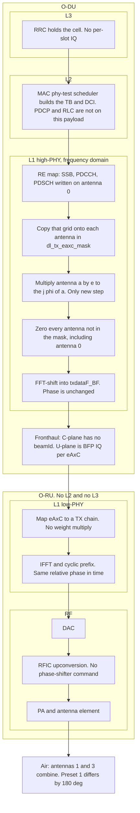
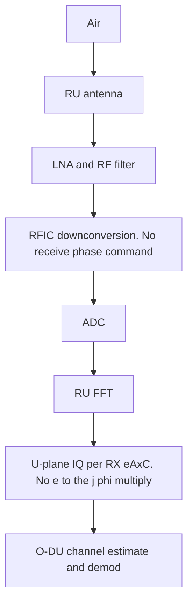

# Phy-test TX phase

| Field | Value |
|---|---|
| Document ID | LATUAN-DES-TXPHASE-001 |
| Title | Phy-test TX phase |
| Type | Implementation design |
| Product | OAI DU, Split 7.2, phy-test |
| Location | `docs/LATUAN_phytest_tx_phase_design.md` |
| Version | 1.1 |
| Release date | 2026.10.29 |
| Status | Released for implementation. Source is unchanged. |
| Classification | Internal |
| Tag | `__PORTING_TM_MODE__` |

## Author list

| Role | Name | Date |
|---|---|---|
| Author | LATUAN | 2026.10.29 |
| Reviewer | — | — |
| Approver | — | — |

## Release

| Revision | Release date | Author | Description |
|---|---|---|---|
| 1.0 | 2026.10.29 | LATUAN | Initial release. Conf-driven TX phase for phy-test, apply function, and porting tag. Runtime CLI is not in this revision. |
| 1.1 | 2026.10.29 | LATUAN | TX chain mapped onto L3, L2, and L1 at the O-DU and onto L1 plus RF at the O-RU. |

## Contents

1. Goal and limits
2. Where the phase sits
3. Selecting the phase in `tm_mode`
4. Apply function
5. Interaction with the current path
6. 256-QAM on the four antennas
7. How to test
8. Implementation
9. Left out of this design

---

Phy-test can apply a relative TX phase without the O-RU receiving a precoding matrix. One downlink waveform (SSB, PDCCH, PDSCH, and DM-RS) is copied from antenna 0 onto the selected eAxC ports. Each selected antenna is then multiplied by a phase from `tm_mode`. The phase is already in the IQ samples before BFP and before fronthaul.

This is a design for implementation. The source is unchanged.

## 1. Goal and limits

The goal is to change the relative phase between TX chains and measure it on RF, one VSA port at a time, while the RU radiates each eAxC as it arrives.

Out of scope:

- Sending a weight matrix or a beamId to the RU.
- A phase shifter inside the RFIC.
- A CSI codebook or a PMI that tracks the UE.
- `independent_stream_mode`. That mode puts a different payload on each antenna. Phasing independent streams does not form one beam.

Run conditions:

| Parameter | Experiment value |
|---|---|
| `--phy-test` | Required. Outside phy-test the function does nothing |
| `independent_stream_mode` | `0` |
| `identity_precoding_matrix` | `1`, or PMI = 0 |
| PDSCH layers | 1, so the PDSCH grid is on antenna 0 before the copy |
| `nb_tx` | 4 on a 4T4R RU |
| `dl_tx_eaxc_mask` | Bits of the antennas that radiate. `0` means all `nb_tx` antennas. `15` means eAxC 0..3 |
| Analog BF / DBT | Off. `nr_feptx()` asserts if `num_dig_beams != 0` |

Antenna 0 in `txdataF` is the source buffer. SSB (`nr_common_signal_procedures`), PDCCH (`nr_dci.c`), and one-layer PDSCH at PMI 0 are all written there. It does not have to be one of the antennas that radiate.

## 2. Where the phase sits

`nr_feptx_tp()` in `openair1/SCHED_NR/nr_ru_procedures.c` is the FEP used by the 7.2 gNB (`ru->feptx_ofdm = nr_feptx_tp`). It pushes one `nr_feptx()` task per antenna. Those tasks read `txdataF` in parallel.

Apply the phase once, on the thread that calls `nr_feptx_tp()`, before `pushTpool`. Do not rotate inside `nr_feptx()`: one antenna task would copy antenna 0 while another task overwrites it. `half_slot_parallelization` splits a slot into two tasks. Rotating the whole slot first means both halves read the rotated buffer.

The multiply is frequency-domain IQ. A later FFT-shift, BFP compression, and the RU IFFT are linear and identical on every chain, so the relative phase between antennas is still there in the time-domain RF signal. A fixed per-chain RF error remains and must be calibrated out of the measurement.

### TX chain

Mask `10` and preset 1: only antennas 1 and 3 leave the DU, at −90° and −270°. The new multiply is one step inside O-DU L1 high-PHY. L3 and L2 finish before it. The O-RU has no L2 and no L3.



Where each block sits:

| Stack | Node | What runs on this path | Phase |
|---|---|---|---|
| L3 RRC | O-DU | Cell configuration. The waveform is not an RRC message | No |
| L2 PDCP, RLC | O-DU | Not on the phy-test TM payload | No |
| L2 MAC | O-DU | Phy-test scheduler builds the transport block and the DCI. `tm_mode` is read at startup, not each slot | No |
| L1 high-PHY | O-DU | Coding, modulation, RE mapping onto antenna 0, then the copy, the phase multiply, and the zero | Yes. After RE mapping, before fronthaul |
| Fronthaul | O-DU to O-RU | Frequency-domain BFP IQ per eAxC. C-plane does not carry `beamId` | Already in the samples |
| L1 low-PHY | O-RU | eAxC to TX-chain map, IFFT, cyclic prefix | No extra multiply. Relative phase is kept |
| L2 and L3 | O-RU | Not present on Split 7.2 | — |
| RF | O-RU | DAC, RFIC, PA, antenna | Fixed per-chain RF error only |

What each stage holds for that example:

| Stage | Antenna 0 | Antenna 1 | Antenna 2 | Antenna 3 |
|---|---|---|---|---|
| After high-PHY | 256-QAM, 0° | empty | empty | empty |
| After copy | 256-QAM, 0° | same grid, 0° | empty | same grid, 0° |
| After multiply | 0° | −90° | empty | −270° |
| After zero | empty | −90° | empty | −270° |
| U-plane, IFFT, RF | empty | −90° plus that chain's fixed RF error | empty | −270° plus that chain's fixed RF error |

`phytest_replicate_ssb_to_tx_antennas()` may already have copied SSB at the same phase. The new step overwrites the whole symbol from antenna 0, so that earlier copy is not the final result. Antennas outside the mask are cleared, including any SSB that was replicated onto them.

Do not edit IQ after xran BFP. Do not use `timeshift_symbol_rotation`. That rotation is a common timing shift on every antenna, not a phase offset between ports.

### RX chain

Nothing in `tm_mode` rotates the receive path. IQ returns per eAxC and the DU demodulates it as it arrives.



A receive beam weight would be a new multiply, either in the RU after the FFT or in the DU after the U-plane is unpacked. This design does not add that multiply. The TX phase still changes what a UE or a probe hears, because the radiated waves already carry the offset.

### Relation to beam control

The relative phase is how a beam is formed in the air. It does not travel the O-RAN beam-control path.

| What beam control usually does | This phase experiment |
|---|---|
| MAC selects a beam from SSB, RSRP, or CSI | No beam selection. The phase stays in `tm_mode` until the conf is edited |
| C-plane carries `beamId` | `nBeamIndex` is not written |
| RU looks up a weight table or drives a phase shifter | RU radiates each eAxC. It does not receive \(W\) |
| Weights may change per slot or per UE | One phase set for the whole slot, every RE, every UE |

A VSA phase offset between ports shows that the DU wrote the phase. It does not show that the RU has beam control. Beam control is confirmed when the RU changes phase, or the radiation pattern changes, while the per-eAxC IQ stays the same and only `beamId` changes.

## 3. Selecting the phase in `tm_mode`

The phase is read from the `tm_mode` block of the gNB conf, on the same path as `dl_tx_eaxc_mask` and `independent_stream_mode`. Change the experiment by editing the conf and restarting the DU. No source edit and no rebuild.

Declare the new keys next to the other `tm_mode` keys in `openair2/GNB_APP/gnb_paramdef.h`. Parse them in `executables/nr-softmodem.c` with `config_get()` on section `tm_mode`.

| Key | Type | Default | Meaning |
|---|---|---|---|
| `tx_phase_preset` | int | `-1` | `-1` off. `0`..`3` selects a built-in row |
| `tx_phase_deg` | string | `""` | Degrees per antenna, comma-separated. A non-empty string wins over the preset |

If `tx_phase_preset` is `-1` and `tx_phase_deg` is empty, the phase function does not run. Existing phy-test confs keep their current behavior.

The preset table lives in code, not in the conf:

| Preset | ant0 | ant1 | ant2 | ant3 |
|---:|---:|---:|---:|---:|
| 0 | 0 | 0 | 0 | 0 |
| 1 | 0 | −90 | −180 | −270 |
| 2 | 0 | 90 | 180 | 270 |
| 3 | 0 | 45 | 90 | 135 |

Example for a 4x4 conf, preset 1. `independent_stream_mode` must be 0. The current DL 256-QAM conf sets that flag to 1. Turn it off in the same `tm_mode` block when phase is enabled.

```
tm_mode = {
  independent_stream_mode = 0;
  dl_tx_eaxc_mask = 15;
  tx_phase_preset = 1;
  tx_phase_deg = "";
};
```

Custom degrees, four antennas, preset ignored:

```
tm_mode = {
  independent_stream_mode = 0;
  dl_tx_eaxc_mask = 15;
  tx_phase_preset = -1;
  tx_phase_deg = "0,-90,-180,-270";
};
```

Antennas 1 and 3 only, preset 1 (−90° and −270°):

```
dl_tx_eaxc_mask = 10;
tx_phase_preset = 1;
```

`10` is `0b1010`. Antennas 0 and 2 are silent. Antennas 1 and 3 carry the same waveform at the ant1 and ant3 columns of the preset.

One antenna only is mask `1` (antenna 0). Masks `2`, `4`, and `8` are valid too: the source buffer is still antenna 0, then that buffer is cleared because bit 0 is off. Every preset stores 0° on antenna 0, so mask `1` looks the same for presets 0..3. To rotate that single port, set its degree explicitly, for example `tx_phase_deg = "45,0,0,0"` with mask `1`.

Parse rules, once at startup:

1. Without `--phy-test`: ignore both keys and leave phase off. Log one line if the preset is not −1 or the degree string is not empty.
2. A non-empty `tx_phase_deg` is split on commas into integers. Compare the count with `nb_tx` when the antenna count is known, at the same time as `dl_tx_eaxc_mask` validation, not inside `config_get()`. A bad token or a bad count logs an error and turns phase off.
3. An empty string and `tx_phase_preset` in 0..3 selects that row. Any other preset logs an error and turns phase off.
4. When both are valid, the degree string wins. Log one line that the preset was ignored.
5. Wrap each degree into \([-180, 180]\), convert to `c16_t` Q15, and store `phytest_tx_phase_q15[nb_tx]`. Set `phytest_tx_phase_on = 1`.

Amplitude is always 1. There is no gain key.

Convert degrees to Q15 once. Do not call `cos` or `sin` per RE:

| Degrees | Q15 `(r, i)` |
|---:|---|
| 0 | `(32767, 0)` |
| 90 | `(0, 32767)` |
| −90 | `(0, -32767)` |
| 180 or −180 | `(-32767, 0)` |
| −270 | `(0, 32767)`, because −270° is 90° |
| other | `(round(cos φ · 32767), round(sin φ · 32767))` |

The special angles are exact so that a +90° multiply turns \(I+jQ\) into \(-Q+jI\) without rounding error.

`dl_tx_eaxc_mask` selects the radiating ports, not the source buffer. Bits at or above `nb_tx` are dropped. If the mask is empty after that, log an error and turn phase off.

Mask `0` is not expanded by `phytest_dl_tx_eaxc_validate_config()` when `independent_stream_mode` is 0. That function returns immediately in this experiment. The phase finalizer in section 8 expands mask `0` to `(1 << nb_tx) - 1` itself.

## 4. Apply function

```c
void phytest_apply_tx_phase(c16_t **txdataF,
                            int nb_tx,
                            int ofdm_symbol_size,
                            int symbols_per_slot,
                            uint32_t eaxc_mask);
```

Call it from `nr_feptx_tp()` after the uplink-slot return and before `pushTpool`. The uplink return is the existing `nr_slot_select(...) == NR_UPLINK_SLOT` check. A mixed slot still transmits, so the phase runs on that slot too.

```c
if (get_softmodem_params()->phy_test && phytest_tx_phase_on) {
  if (phytest_independent_stream_mode)
    LOG_E(PHY, "tx phase ignored: independent_stream_mode=1\n");
  else
    phytest_apply_tx_phase(ru->gNB_list[0]->common_vars.txdataF[0],
                           ru->nb_tx,
                           fp->ofdm_symbol_size,
                           fp->symbols_per_slot,
                           phytest_dl_tx_eaxc_mask);
}
```

Beam 0 only. Analog BF is off, so `num_beams_period` is 1.

Per slot:

1. `mask = eaxc_mask != 0 ? eaxc_mask : (1u << nb_tx) - 1`, then clear every bit `≥ nb_tx`. If the mask is 0, log an error and return.
2. For each antenna `a` in the mask with `a != 0`: `memcpy` the whole slot from `txdataF[0]` while the source is still unrotated.
3. For each antenna `a` in the mask: every RE `c16mulShift(x, w[a], 15)`.
4. For each antenna not in the mask: `memset` the whole slot to 0. Antenna 0 is cleared here when bit 0 is off, after step 2 has finished the copies.

`c16mulShift` is in `openair1/PHY/TOOLS/tools_defs.h`. A Q15 weight of magnitude 32767 keeps the amplitude across the 15-bit shift. Samples near full scale stay inside `int16` when \(|w| \le 32767\).

Guard REs and DC go through the same loop. One coefficient per antenna means the phase offset does not depend on the RE. DM-RS takes the same phase as PDSCH on that antenna. A one-antenna UE can still estimate the combined channel, unless the paths sum to a null at the UE.

Log once at init, not every slot:

```
phy-test tx phase on mask 0xF deg [0, -90, -180, -270] source preset 1
```

`source` is `preset N` or `tx_phase_deg`.

## 5. Interaction with the current path

| Current path | When phase is on |
|---|---|
| `do_txdataF()` PMI 0 | Unchanged. It writes layer 0 onto antenna 0. Phase does not call `nr_layer_precoder_simd` |
| `independent_stream_mode` | Incompatible. Phase does not run. An error is logged |
| SSB replicate by mask | Overwritten by the full-symbol copy. SSB ends up at the preset phase |
| PDCCH on antenna 0 only | Copied with the symbol, then rotated |
| `nr_feptx()` FFT shift | Reads the rotated buffer. It does not apply a weight |
| C-plane `nBeamIndex` | Unchanged. No beamId is sent |
| UL | `rxdataF` is not touched |

The `AssertFatal` for a non-zero PMI inside `independent_stream_mode` does not apply, because this experiment turns that mode off.

## 6. 256-QAM on the four antennas

The phase from `tm_mode` multiplies every RE of an antenna by \(e^{j\phi}\), with \(|w| = 1\). PDSCH 256-QAM on each antenna stays a square grid of levels \(\pm 1, \pm 3, \ldots, \pm 15\), at the same amplitude. The whole grid rotates about the origin. The modulation order does not change.

Plot PDSCH data REs only. DM-RS and PDCCH are QPSK. SSB is not on the 256-QAM alphabet. Plotting a whole symbol mixes those constellations.

### Preset 1, 90° steps


The four clouds match. A square 256-QAM grid rotated by 90° lands on the same point locations. A point moves to another cell. The square stays aligned with the I and Q axes.

The same corner symbol \((15, 15)\) on antenna 0 walks around the four corners. That is where the phase shows up when the cloud shape does not change:

| Antenna | Phase | Symbol \((15, 15)\) after rotation |
|---:|---:|---|
| 0 | 0° | \((15,\ 15)\) |
| 1 | −90° | \((15,\ -15)\) |
| 2 | −180° | \((-15,\ -15)\) |
| 3 | −270° | \((-15,\ 15)\) |

Mapping: 0° leaves \((I, Q)\) unchanged, −90° maps it to \((Q, -I)\), 180° maps it to \((-I, -Q)\), and −270° maps it to \((-Q, I)\).

Presets 0 and 2 also produce four overlapping squares. Preset 0 leaves the corner at \((15, 15)\) on every antenna. Preset 2 walks the opposite way around the square.

### Preset 3, 45° steps


An angle that is not a multiple of 90° changes the shape of the cloud. The orange point is symbol \((15, 15)\) after rotation. At 45° it lands near \((0,\ 21)\), because \(15\sqrt{2} \approx 21.2\), outside the original \(\pm 15\) box:

| Antenna | Phase | PDSCH 256-QAM shape |
|---:|---:|---|
| 0 | 0° | square, edges parallel to the I and Q axes |
| 1 | 45° | same grid, rotated into a diamond |
| 2 | 90° | square, same cloud as antenna 0 |
| 3 | 135° | diamond, same cloud as antenna 1 |

### Reading it on a VSA

A VSA that locks phase per port pulls every antenna back to an upright square. EVM stays good because DM-RS rotates by the same angle as the data. The four pictures then look like preset 0 even when the preset is 1.

To see the offset, keep one phase reference and read \(\arg(x_a \cdot x_0^*)\) on PDSCH REs. Preset 1 gives four clusters at \(0°, -90°, -180°, -270°\). With mask `10`, antennas 0 and 2 have no energy, so the reference is the unrotated source before antenna 0 is cleared, or the relative angle between ports 1 and 3, which is 180°.

## 7. How to test

1. DL phy-test 4x4 conf: `nb_tx = 4`, one layer, `independent_stream_mode = 0`, `identity_precoding_matrix = 1`, `dl_tx_eaxc_mask = 15`, `tx_phase_deg = ""`.
2. Set `tx_phase_preset = 0` and restart the DU. The log must contain `deg [0, 0, 0, 0]`. On four ports: the same PDSCH and SSB amplitude, relative phase near 0°. The residual is the fixed RF phase. Record it as the baseline.
3. Set `tx_phase_preset = 1` and restart. On the same symbol and the same ports, the extra phase is about \(0, -90, -180, -270\) degrees from the preset 0 baseline. Per-port power stays about the same. The 256-QAM cloud on each port is still a square (section 6). Compare the corner symbol or \(\arg(x_a \cdot x_0^*)\). Do not decide the phase from the cloud shape. For an angle outside the table, leave the preset at −1 and fill `tx_phase_deg`.
4. Mask `10` (eAxC 1 and 3 only): ports 0 and 2 have no energy. With preset 1, port 1 is −90° and port 3 is −270° relative to the antenna 0 source before that source is cleared. Mask `3` (eAxC 0 and 1): ports 2 and 3 are silent, and port 1 is −90° from port 0. Mask `1`: only port 0 radiates, at 0° for every built-in preset.
5. Capture the U-plane: one PC_ID per radiating eAxC, non-zero IQ on the mask, and an \(I,Q\) relation that matches the rotation. At 90°, \(I+jQ\) becomes \(-Q+jI\) relative to antenna 0.
6. Look at UE throughput only after the VSA phases are right. A UE outside the combined direction can lose sync while each RF port still has the correct phase.

If preset 0 already shows a large phase offset across the four ports, and preset 1 does not add the expected steps on top of that baseline, the RU is applying its own beam or weight, or the eAxC map is not one-to-one. Stop and check the RU capability before trying another preset.

## 8. Implementation

The blocks below are the contract for the first patch. Do not invent a second config path or a second multiply later in FHI.

### 8.1 Files

| File | Change |
|---|---|
| `openair2/GNB_APP/gnb_paramdef.h` | Key names and help strings, next to `dl_tx_eaxc_mask` |
| `executables/nr-softmodem.h` | `extern` for the new globals |
| `executables/nr-softmodem.c` | `config_get()` in the existing `tm_mode` block, after `dl_tx_eaxc_mask` |
| `openair2/LAYER2/NR_MAC_gNB/oai_porting_phytest.h` | Declare `phytest_tx_phase_finalize()` and `phytest_apply_tx_phase()` |
| `openair2/LAYER2/NR_MAC_gNB/gNB_scheduler_phytest.c` | Define the globals and `phytest_tx_phase_finalize()` |
| `openair1/PHY/MODULATION/phytest_tx_phase.c` | Define `phytest_apply_tx_phase()`. New file |
| `openair1/SCHED_NR/nr_ru_procedures.c` | One call inside `nr_feptx_tp()` |
| `CMakeLists.txt` | Add the new `.c` to `PHY_NR_SRC` only, next to `nr_modulation.c` (around line 1007). Do not add it to `PHY_NR_UE_SRC` |

Every edit to an existing file uses this wrapper. The new code is the `#if 1` branch. The stock lines stay in the `#else` branch so the original can be restored by changing `1` to `0`. A pure insertion has an empty `#else` and a comment that stock OAI had nothing there. The `#endif` repeats the same tag.

```c
#if 1 /* tm_mode tx_phase, LATUAN 2026.10.29 __PORTING_TM_MODE__ */
  /* new code */
#else /* original, LATUAN 2026.10.29 __PORTING_TM_MODE__ */
  /* stock OAI, unchanged */
#endif /* tm_mode tx_phase, LATUAN 2026.10.29 __PORTING_TM_MODE__ */
```

`phytest_tx_phase.c` is a new file, so it has no stock body to put in `#else`. Do not wrap the function itself. Tag the places that pull it in: the header declaration, the `CMakeLists.txt` line, the `config.c` call, and the `nr_feptx_tp()` call.

### 8.2 Globals

The definitions in `gNB_scheduler_phytest.c` and the `extern` lines in `nr-softmodem.h` use the same `#if 1 /* tm_mode tx_phase, LATUAN 2026.10.29 __PORTING_TM_MODE__ */` wrapper. The `#else` branch is empty.

```c
#if 1 /* tm_mode tx_phase, LATUAN 2026.10.29 __PORTING_TM_MODE__ */
#define PHYTEST_TX_PHASE_DEG_MAX 64

int phytest_tx_phase_preset;                 /* conf, default -1 */
char phytest_tx_phase_deg_buf[PHYTEST_TX_PHASE_DEG_MAX];
char *phytest_tx_phase_deg;                  /* points at the buffer */
int phytest_tx_phase_on;                     /* 0 until finalize succeeds */
int phytest_tx_phase_nb;                     /* antenna count the weights were built for */
c16_t phytest_tx_phase_q15[PHYTEST_DL_TX_EAXC_MAX];
int phytest_tx_phase_deg_applied[PHYTEST_DL_TX_EAXC_MAX]; /* wrapped degrees, for the log */
#else /* original, LATUAN 2026.10.29 __PORTING_TM_MODE__ */
#endif /* tm_mode tx_phase, LATUAN 2026.10.29 __PORTING_TM_MODE__ */
```

`PHYTEST_DL_TX_EAXC_MAX` is already 4. This experiment does not support more than four TX ports. Initialize `phytest_tx_phase_preset` to `-1`, `phytest_tx_phase_on` to 0, and the degree buffer to an empty string. `config_get()` overwrites them when the keys are present.

`tx_phase_preset` is signed. Use `TYPE_INT` and `.iptr`. A `TYPE_UINT` cannot store `-1`.

### 8.3 Read the conf

In `nr-softmodem.c`, in the same `config_get()` area as `dl_tx_eaxc_mask`:

```c
#if 1 /* tm_mode tx_phase, LATUAN 2026.10.29 __PORTING_TM_MODE__ */
  paramdef_t tmmode_tx_phase[] = {
    { "tx_phase_preset",
      "PHYTEST: -1=off, 0..3=built-in phase row\n",
      0, .iptr = &phytest_tx_phase_preset, .defintval = -1, TYPE_INT, 0 },
    { "tx_phase_deg",
      "PHYTEST: comma-separated degrees per TX antenna; non-empty overrides tx_phase_preset\n",
      0, .strptr = &phytest_tx_phase_deg, .defstrval = "", TYPE_STRING,
      sizeof(phytest_tx_phase_deg_buf) },
  };
  config_get(cfg, tmmode_tx_phase, sizeofArray(tmmode_tx_phase), GNB_CONFIG_STRING_TM_MODE);
#else /* original, LATUAN 2026.10.29 __PORTING_TM_MODE__ */
  /* stock OAI has no tx_phase keys */
#endif /* tm_mode tx_phase, LATUAN 2026.10.29 __PORTING_TM_MODE__ */
```

Give the string its own buffer the same way `dl_prb_alloc_mode` does (`phytest_tx_phase_deg = phytest_tx_phase_deg_buf` before `config_get`). Do not decide `phytest_tx_phase_on` here. `nb_tx` is not known yet.

If `--phy-test` is not set, leave `phytest_tx_phase_on` at 0 even when the keys are filled. Log one warning when the preset is not `-1` or the string is not empty.

### 8.4 Finalize when the port count is known

Call `phytest_tx_phase_finalize(num_pdsch_antenna_ports)` from `nr_mac_config_scc()` in `openair2/LAYER2/NR_MAC_gNB/config.c`, on the line after `phytest_dl_tx_eaxc_validate_config()`:

```c
  phytest_dl_tx_eaxc_validate_config(num_pdsch_antenna_ports);
#if 1 /* tm_mode tx_phase, LATUAN 2026.10.29 __PORTING_TM_MODE__ */
  phytest_tx_phase_finalize(num_pdsch_antenna_ports);
#else /* original, LATUAN 2026.10.29 __PORTING_TM_MODE__ */
#endif /* tm_mode tx_phase, LATUAN 2026.10.29 __PORTING_TM_MODE__ */
```

Do not put this work inside `phytest_dl_tx_eaxc_validate_config()`. That function returns at once when `independent_stream_mode` is 0, which is the phase experiment.

`phytest_tx_phase_finalize(int num_tx_ant)`:

1. Set `phytest_tx_phase_on = 0`.
2. Return if `!get_softmodem_params()->phy_test`.
3. If `phytest_independent_stream_mode` is set and phase was requested (preset in 0..3, or a non-empty degree string): log one error, `tx phase ignored: independent_stream_mode=1`, and return. Do not log this again per slot.
4. If the degree string is empty and the preset is `-1`, return. Phase stays off.
5. Reject `num_tx_ant < 1` or `num_tx_ant > PHYTEST_DL_TX_EAXC_MAX`. Log one error and return. The 4T4R conf has `num_tx_ant == 4` (`N1 * N2 * XP`).
6. Build the degree vector `deg[num_tx_ant]`:
   - Non-empty string: split on commas. Allow spaces around tokens. Reject an empty token, a trailing comma, a non-integer, and a count other than `num_tx_ant`. On failure, log the string and return.
   - Empty string: preset must be 0, 1, 2, or 3. Copy the first `num_tx_ant` columns of that row. If both the string and a preset are set, the string wins and one info line says the preset was ignored.
7. Wrap each degree into `[-180, 180]` (`-270` becomes `90`). Store the wrapped values in `phytest_tx_phase_deg_applied[]`.
8. Fill `phytest_tx_phase_q15[]` from the table in section 3. Use the exact Q15 pairs for 0, ±90, and ±180. Any other angle uses `llround(cos(φ) * 32767)` and `llround(sin(φ) * 32767)` once, here, with `φ` in radians.
9. Resolve the mask. `phytest_dl_tx_eaxc_validate_config()` has not expanded it:
   - `phytest_dl_tx_eaxc_mask == 0`: set it to `(1u << num_tx_ant) - 1u` and log the expansion.
   - Else if any bit at or above `num_tx_ant` is set: log an error and return without enabling phase. Do not `AssertFatal`; a bad phase conf must not kill a DU that can still run without phase.
10. Set `phytest_tx_phase_nb = num_tx_ant` and `phytest_tx_phase_on = 1`.
11. Log once:

```
phy-test tx phase on mask 0xA deg [0, -90, 0, -270] source preset 1
```

`source` is `preset N` or `tx_phase_deg`. The degree list is the wrapped list, including antennas the mask will later silence.

`RUs.nb_tx` is not an argument of this function. The 4x4 conf sets it equal to `num_pdsch_antenna_ports`. Section 8.6 checks them again at the RU.

### 8.5 Weights

Preset rows, columns ant0..ant3. A smaller `num_tx_ant` uses the leading columns only.

| Preset | 0 | 1 | 2 | 3 |
|---:|---:|---:|---:|---:|
| 0 | 0 | 0 | 0 | 0 |
| 1 | 0 | −90 | −180 | −270 |
| 2 | 0 | 90 | 180 | 270 |
| 3 | 0 | 45 | 90 | 135 |

Q15 after wrapping:

| Wrapped degrees | `c16_t` |
|---:|---|
| 0 | `{32767, 0}` |
| 90 and −270 | `{0, 32767}` |
| −90 and 270 | `{0, -32767}` |
| 180 and −180 | `{-32767, 0}` |

`c16mulShift(x, w, 15)` with `|w| == 32767` keeps the amplitude. `32767 * 32767 >> 15` still fits in `int16`. Do not skip the multiply for a 0° weight. One loop is easier to review than a special case.

### 8.6 Apply on the DL slot

`gNB->common_vars.txdataF[beam][ant]` is one slot of frequency-domain IQ. The allocation is `samples_per_slot_wCP` samples, and that length is `symbols_per_slot * ofdm_symbol_size` (`nr_parms.c`). It is not a frame buffer and it has no cyclic prefix. Copy and clear that many `c16_t`, not `symbols_per_slot` alone.

Put the text below into `openair1/PHY/MODULATION/phytest_tx_phase.c` as the function body. It is the complete function, not a sketch. `phytest_tx_phase_on`, `phytest_tx_phase_nb`, and `phytest_tx_phase_q15[]` are defined in `gNB_scheduler_phytest.c` and declared in `oai_porting_phytest.h`.

```c
/*
 * SPDX-License-Identifier: LicenseRef-CSSL-1.0
 */

#include <stddef.h>
#include <stdint.h>
#include <string.h>

#include "PHY/TOOLS/tools_defs.h"
#include "common/utils/LOG/log.h"
#include "openair2/LAYER2/NR_MAC_gNB/oai_porting_phytest.h"

/*
 * Copy antenna 0 onto every selected TX port, multiply each selected port
 * by its Q15 phase, then zero every port that is not selected.
 *
 * txdataF[a]  one slot, frequency domain, length nsamps
 *             (samples_per_slot_wCP == symbols_per_slot * ofdm_symbol_size)
 * nb_tx       must equal phytest_tx_phase_nb, and be in 1..PHYTEST_DL_TX_EAXC_MAX
 * nsamps      sample count of one antenna buffer; must be > 0
 * eaxc_mask   bit a selects antenna a. Bit 0 may be clear: antenna 0 is
 *             still the copy source, then it is zeroed.
 *
 * Returns 0 on success. Returns -1 without writing if the call is a no-op
 * or the arguments are unusable. A no-op (phase off) is silent. A bad
 * argument logs once.
 */
int phytest_apply_tx_phase(c16_t **txdataF, int nb_tx, int nsamps, uint32_t eaxc_mask)
{
  static int bad_args_logged;

  if (!phytest_tx_phase_on)
    return -1;

  if (txdataF == NULL || nsamps <= 0 || nb_tx != phytest_tx_phase_nb || nb_tx < 1 ||
      nb_tx > PHYTEST_DL_TX_EAXC_MAX) {
    if (!bad_args_logged) {
      bad_args_logged = 1;
      LOG_E(PHY,
            "phytest_apply_tx_phase skipped: txdataF %p nsamps %d nb_tx %d phase_nb %d\n",
            (void *)txdataF,
            nsamps,
            nb_tx,
            phytest_tx_phase_nb);
    }
    return -1;
  }

  /* nb_tx <= 4, so the shift is defined. */
  const uint32_t mask = eaxc_mask & ((1u << nb_tx) - 1u);
  if (mask == 0) {
    if (!bad_args_logged) {
      bad_args_logged = 1;
      LOG_E(PHY, "phytest_apply_tx_phase skipped: eaxc_mask 0x%x has no bit in 0..%d\n", eaxc_mask, nb_tx - 1);
    }
    return -1;
  }

  /*
   * Antenna 0 is the source even when it will not radiate.
   * Every radiating antenna must have a buffer before any copy starts,
   * so a NULL pointer cannot leave a half-updated slot.
   */
  if (txdataF[0] == NULL) {
    if (!bad_args_logged) {
      bad_args_logged = 1;
      LOG_E(PHY, "phytest_apply_tx_phase skipped: antenna 0 buffer is NULL\n");
    }
    return -1;
  }
  for (int a = 0; a < nb_tx; a++) {
    if ((mask & (1u << a)) && txdataF[a] == NULL) {
      if (!bad_args_logged) {
        bad_args_logged = 1;
        LOG_E(PHY, "phytest_apply_tx_phase skipped: antenna %d buffer is NULL (mask 0x%x)\n", a, mask);
      }
      return -1;
    }
  }

  const size_t nbytes = (size_t)nsamps * sizeof(c16_t);

  /* 1. Copy the unrotated source. Do not copy antenna 0 onto itself. */
  for (int a = 1; a < nb_tx; a++) {
    if (mask & (1u << a))
      memcpy(txdataF[a], txdataF[0], nbytes);
  }

  /* 2. Rotate only the ports that will radiate, including antenna 0 if selected. */
  for (int a = 0; a < nb_tx; a++) {
    if ((mask & (1u << a)) == 0)
      continue;
    c16_t *x = txdataF[a];
    const c16_t w = phytest_tx_phase_q15[a];
    for (int k = 0; k < nsamps; k++)
      x[k] = c16mulShift(x[k], w, 15);
  }

  /* 3. Silence the other ports. Antenna 0 is cleared here only after step 1. */
  for (int a = 0; a < nb_tx; a++) {
    if ((mask & (1u << a)) == 0)
      memset(txdataF[a], 0, nbytes);
  }

  return 0;
}
```

Declaration in `oai_porting_phytest.h`:

```c
#if 1 /* tm_mode tx_phase, LATUAN 2026.10.29 __PORTING_TM_MODE__ */
int phytest_apply_tx_phase(c16_t **txdataF, int nb_tx, int nsamps, uint32_t eaxc_mask);
#else /* original, LATUAN 2026.10.29 __PORTING_TM_MODE__ */
#endif /* tm_mode tx_phase, LATUAN 2026.10.29 __PORTING_TM_MODE__ */
```

`c16_t` comes from `PHY/TOOLS/tools_defs.h`, which that header must include, or the declaration stays in `phytest_tx_phase.c`'s users via `nr_ru_procedures.c` including `tools_defs.h` first. Prefer the declaration in `oai_porting_phytest.h` and include `tools_defs.h` there.

Order inside the function is mandatory.

1. The copy reads antenna 0 before any rotate and before the clear.
2. Antenna 0 is rotated only when bit 0 is set.
3. Antenna 0 is cleared only when bit 0 is clear, and only after the copy.
4. A 0° weight is still multiplied. `c16mulShift` by `{32767, 0}` with shift 15 reproduces the sample.
5. On any reject path the function returns before the first `memcpy`, so the high-PHY grid is unchanged.

The RU guard is not inside `phytest_apply_tx_phase()`. It is the only caller, and it is written in full in `nr_feptx_tp()` after the uplink-slot return and before `pushTpool`:

```c
if (nr_slot_select(cfg, frame_tx, slot) == NR_UPLINK_SLOT)
  return;

#if 1 /* tm_mode tx_phase, LATUAN 2026.10.29 __PORTING_TM_MODE__ */
  if (phytest_tx_phase_on) {
    static int mismatch_logged;
    NR_DL_FRAME_PARMS *fp = ru->nr_frame_parms;
    if (ru->gNB_list[0] == NULL || fp == NULL || ru->nb_tx != phytest_tx_phase_nb ||
        ru->num_beams_period != 1) {
      if (!mismatch_logged) {
        mismatch_logged = 1;
        LOG_E(PHY,
              "phytest_apply_tx_phase not called: nb_tx %d phase_nb %d beams %d\n",
              ru->nb_tx,
              phytest_tx_phase_nb,
              ru->num_beams_period);
      }
    } else {
      phytest_apply_tx_phase(ru->gNB_list[0]->common_vars.txdataF[0],
                             ru->nb_tx,
                             (int)fp->samples_per_slot_wCP,
                             phytest_dl_tx_eaxc_mask);
    }
  }
#else /* original, LATUAN 2026.10.29 __PORTING_TM_MODE__ */
  /* stock nr_feptx_tp goes straight to pushTpool */
#endif /* tm_mode tx_phase, LATUAN 2026.10.29 __PORTING_TM_MODE__ */
```

`CMakeLists.txt` is not run through the C preprocessor, so a C `#if` there would be a syntax error. Inside `PHY_NR_SRC` only, add the file with a comment tag:

```cmake
  # tm_mode tx_phase, LATUAN 2026.10.29 __PORTING_TM_MODE__
  ${OPENAIR1_DIR}/PHY/MODULATION/phytest_tx_phase.c
```

`half_slot_parallelization` may enqueue two `nr_feptx()` tasks per antenna. Both read `txdataF` after `phytest_apply_tx_phase()` returns, so each half sees the same phase. Do not call it from `nr_feptx()`.

Worked buffer for mask `0xA` (`0b1010`), preset 1, `nb_tx = 4`. Antenna 0 holds the slot. Antennas 1 and 3 may hold leftover SSB copies.

| Step | ant 0 | ant 1 | ant 2 | ant 3 |
|---|---|---|---|---|
| On entry | source grid, 0° | leftover | leftover or empty | leftover |
| After copy | source, 0° | copy of source, 0° | untouched | copy of source, 0° |
| After multiply | source, 0° | −90° | untouched | −270° |
| After clear | zero | −90° | zero | −270° |

Antenna 0 is multiplied by `{32767, 0}` only when bit 0 is set. In this mask it is not set, so step 2 leaves it alone and step 3 zeros it.

### 8.7 What stays untouched

- `do_txdataF()` and `nr_layer_precoder_simd()`. Phase assumes PMI 0 because `identity_precoding_matrix = 1`. The apply function does not read `pm_idx`. A non-zero PMI would precod onto several antennas and then be overwritten by the antenna-0 copy.
- `nr_feptx()` FFT-shift and `nr_feptx0()` IFFT. They run on the buffer phase already wrote.
- `radio/fhi_72/oaioran.c`. No BFP change and no `nBeamIndex` change.
- `rxdataF`, PUSCH, and SRS.

### 8.8 Failure behavior

| Condition | Result |
|---|---|
| Keys absent, or preset `-1` and empty string | Phase off. No log beyond the normal tm_mode dump |
| Not `--phy-test` | Phase off. One warning if the keys requested phase |
| `independent_stream_mode = 1` and phase requested | Phase off. One error at finalize |
| Bad degree string or bad preset | Phase off. One error naming the bad value. DU keeps running |
| Mask bit above `num_tx_ant` | Phase off. One error. Do not abort the process |
| `ru->nb_tx` or `num_beams_period` disagrees at run time | Skip the slot rotate. One error. High-PHY output is unchanged |
| Mask `10` with preset 1 | Antennas 1 and 3 radiate at −90° and −270°. Antennas 0 and 2 are zero |

### 8.9 Check before RF

1. Startup log contains one `phy-test tx phase on` line. The mask and the degree list match the conf.
2. Preset `-1` and an empty string produce no such line, and a four-port capture matches today's phy-test.
3. With mask `15` and preset `1`, a frequency-domain dump of one PDSCH RE on antenna 0 and the same RE on antenna 1 satisfies \(x_1 \approx -j\, x_0\) within one LSB (`c16mulShift` by `{0, -32767}`).
4. With mask `10`, that dump is zero on antennas 0 and 2 and non-zero on 1 and 3.
5. Only then measure the RF ports. Section 7 is the RF procedure.

## 9. Left out of this design

- No phase update per slot or per UE. Edit the conf and restart.
- No gain key. Each antenna has amplitude 1.
- SSB and PDSCH are not phased separately. The whole symbol shares one phase, so the VSA and the UE see the same relation.
- DBT stays off, and `nr_beam_precoding()` is not called.
- No RX phase multiply.
