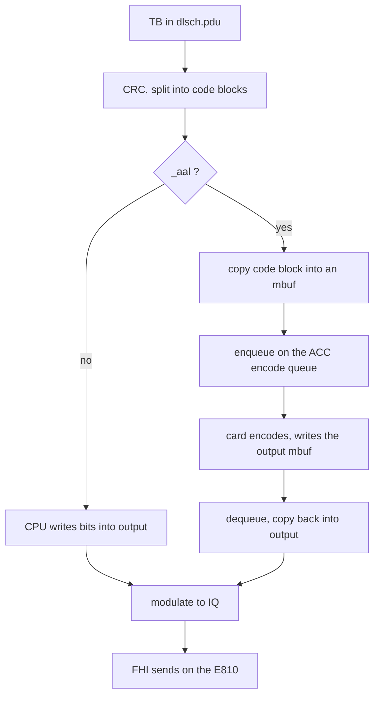

# ACC100 LDPC — accumulated experience

**Author:** LATUAN · **2026.10.20** · `LATUAN_ACC100_LDPC`  
Card is not enabled yet. No measured numbers.

ACC100 encodes and decodes LDPC only. IQ still goes through the E810 at `0000:11:09.0`. OAI uses VF `0d5d`. The PF is `0d5c`. `pf_bb_config` must stay running. `_aal` loads `libldpc_aal.so`. With no key, LDPC stays on the CPU.

## One DL path to remember

The MAC does not call the encoder. `nr_dlsch_encoding` calls a function pointer. With `_aal`, that pointer is the function in `libldpc_aal.so`. The L1 TX thread holds `encode_mutex` until the card finishes.

Encoded bits land in `nr_dlsch`'s `output` buffer. `do_one_dlsch` turns that buffer into IQ. The ACC never sees IQ. Many code blocks in one slot still share one queue. UL is the reverse: E810 to the CPU, then the ACC decode queue. HARQ stays on the card.

## Deploy

Use `systemctl stop/start oai-du` only. `deploy.sh stop` and an `oai-gnb-env` restart can block on hugepages, and a SIGKILL at 10 s leaves the ACC queue stuck.

1. Build with `--build-lib ldpc_aal`. `ldd` must show `/opt/dpdk-22.11.11`.
2. `modprobe vfio-pci enable_sriov=1 disable_idle_d3=1`, bind the PF, run `pf_bb_config` with `acc100_config_1vf_5g.cfg`, set `sriov_numvfs=1`.
3. One UUID, stored in `/var/lib/oai-acc100/`.
4. Two confs only, 100 MHz 4×4 E2E and TM DL: `_aal`, `dpdk_dev` = the VF, `is_t2 = 0`. Leave `dpdk_core_list` unset. Leave the ACC BDF out of `fhi_72.dpdk_devices`.

## Check

Keep ACC as the live path only when all four rows pass. Otherwise restore `nr_softmodem` and `gnb.conf`, and remove `libldpc_aal.so`.

| Step | Pass |
|---|---|
| Card, DU stopped | `dpdk-test-bbdev` passes. On failure, start the old DU. |
| First 60 s | `skipping EAL initialization`, bbdev sees the VF, one encode queue and one decode queue. |
| TM DL, 10 min | No +3 slot jump. MAC drop stays within 5%. |
| E2E | UE attaches. MCS 26 iperf stays within 5% of 950 Mbit/s. Leave iterations at 15 and keep `skip_rx_if_busy`. |

## When it fails

| See | Remember |
|---|---|
| `deploy.sh` stuck | A process still holds hugepages. Wait until `HugePages_Free == HugePages_Total`. |
| DU dies in `nrLDPC_coding_init` | Daemon, UUID, or VF is not on `vfio-pci`. |
| Log says `initializing EAL` | xRAN did not receive the VF. Fix `_aal` and `is_t2 = 0`. |
| Hang ~120 s, then exit | FLR the ACC VF, restart `pf_bb_config`, then start the DU. Leave the PF alone. |
| Throughput drop over 5% | Turn `_aal` off. Leave iterations unchanged for that run. |
| E810 disappears | `oai-gnb-env` was restarted. |
