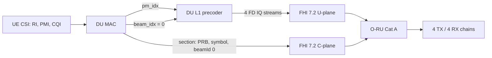
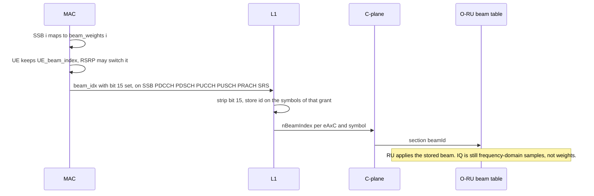
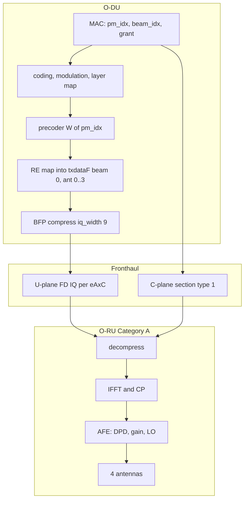
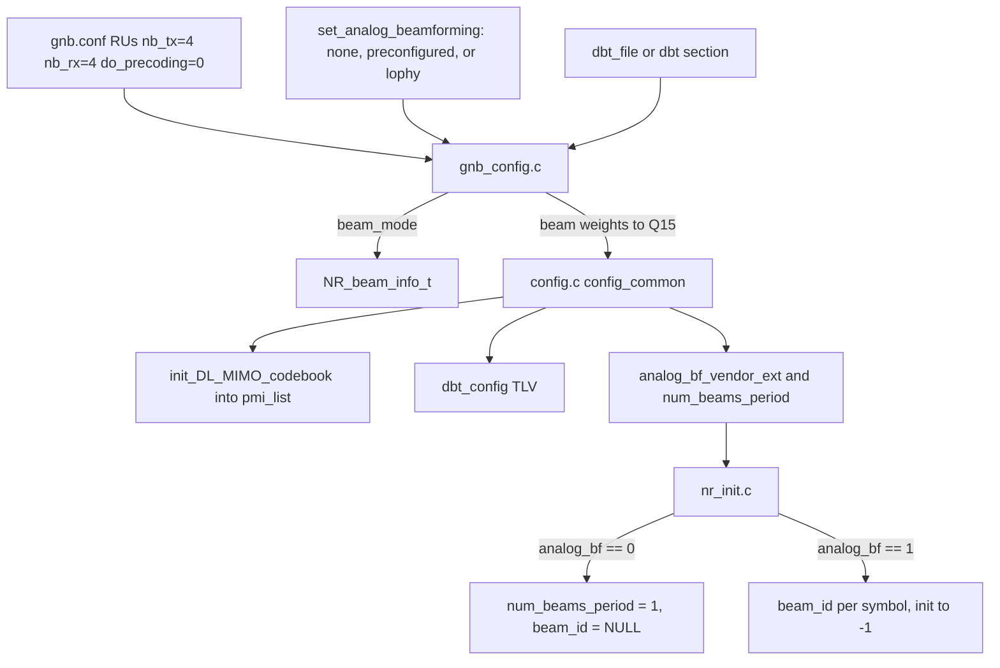
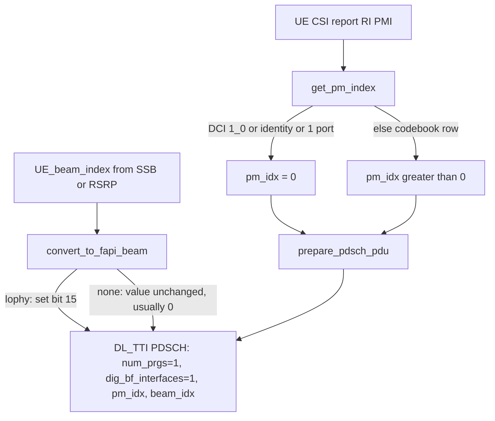
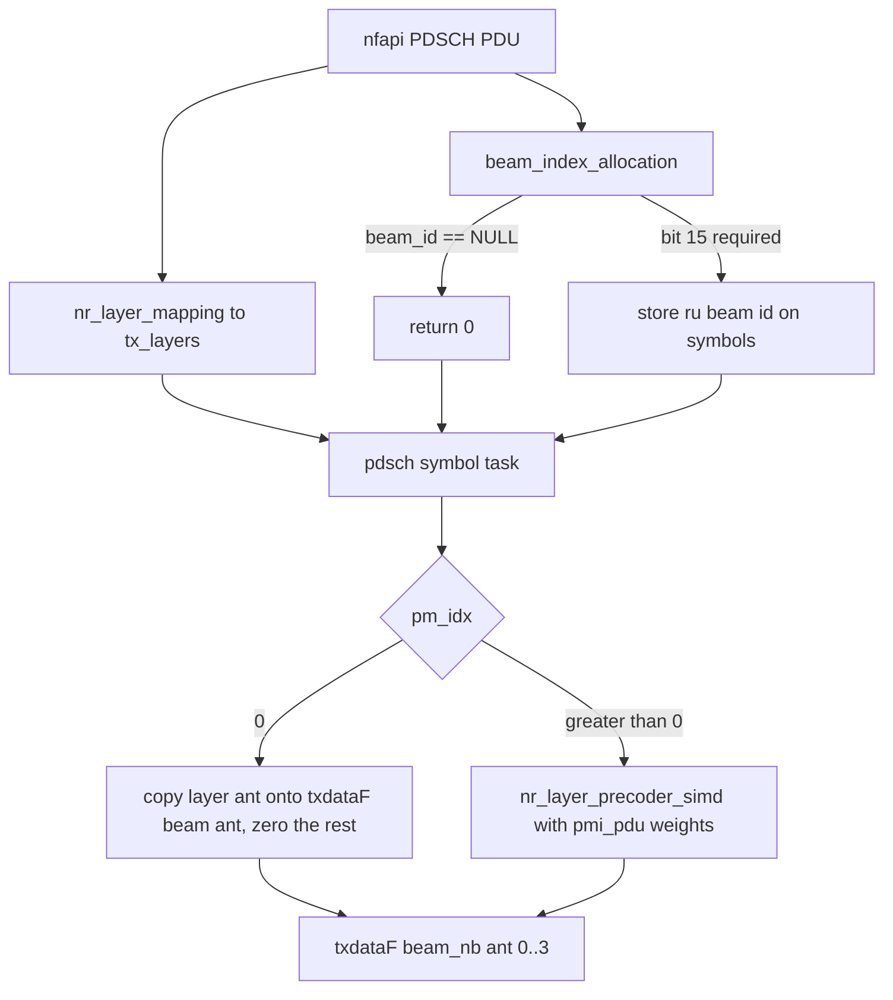
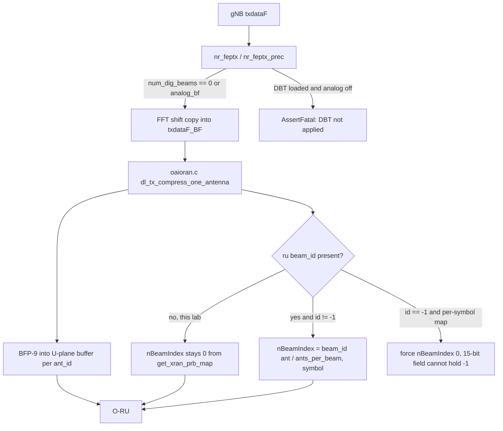
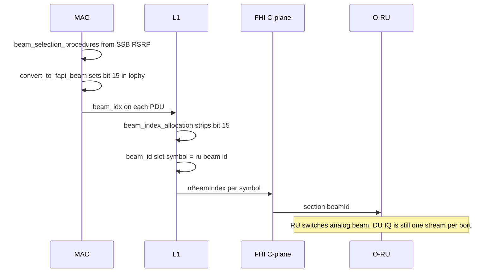

# OAI DU beam control and the 4×4 O-RU (split 7.2x)

This note describes how the OAI DU in this tree controls a 4×4 radio over O-RAN fronthaul split 7.2x, which information the RU must apply, and which antenna and AFE properties that implies. The worked example is the lab profile `configs/gnb/002.gnb.sa.e2e.band79.100mhz.273.fhi72.4x4.dsuuu.conf` (n79, 100 MHz, 273 PRB, 4 TX / 4 RX, DSUUU).

Source tree: `sources/openairinterface5g-v26.w14`.

## 1. What this DU actually does

Two different controls share the FAPI name "beamforming". Only the first one is active on the 4×4 profile.

| Control | FAPI field | Where it is applied | 4×4 profile |
|---|---|---|---|
| Digital precoding | `precodingAndBeamforming.pm_idx` | DU L1, before IQ is compressed | On. Codebook from UE RI/PMI. `pm_idx = 0` is identity. |
| Analog / RU beam index | `dig_bf_interface_list[].beam_idx` | O-RAN C-plane `beamId` (`nBeamIndex`) | Off. `set_analog_beamforming` is unset, so the mode is `none` and `beam_idx` stays 0. |

The xRAN integration is hardcoded to **Category A** (`get_xran_config()` in `radio/fhi_72/oran-config.c`). In Category A the O-DU sends one frequency-domain spatial stream per logical antenna port. The O-RU does not apply a precoding matrix and does not own a digital beam table. `RUs.do_precoding = 0` matches that: the RU thread only copies already-precoded IQ onto the fronthaul.



## 2. Picture of a 4×4 cell

`pdsch_AntennaPorts_N1 = 2`, `pdsch_AntennaPorts_N2` defaults to 1, `pdsch_AntennaPorts_XP = 2`. CSI-RS port count is `N1 * N2 * XP = 4`. `maxMIMO_layers = 4` and `pusch_AntennaPorts = 4`. Logical ports 1000–1003 are the four eAxC flows.

```text
                         DU L1 (Category A)
        layers                         precoder W(pm_idx)              eAxC
        L0 ──────────────────────────► port 1000  ── eAxC ruPort 0 ──► TX0 ── AFE0 ── ant0
        L1 ──────────────────────────► port 1001  ── eAxC ruPort 1 ──► TX1 ── AFE1 ── ant1
        L2 ──────────────────────────► port 1002  ── eAxC ruPort 2 ──► TX2 ── AFE2 ── ant2
        L3 ──────────────────────────► port 1003  ── eAxC ruPort 3 ──► TX3 ── AFE3 ── ant3

        UL is the reverse: ant0..3 → RX AFE → FFT → eAxC 0..3 → DU equalizer
        The RU does not see L0..L3. It sees the four streams after W.
```

eAxC ID layout without M-plane (`set_fh_eaxcid_conf`, Category A), 16 bits:

| Field | Mask | Bits | Lab value |
|---|---|---|---|
| DU port | `0xF000` | 15..12 | 0 |
| Band / sector | `0x0F00` | 11..8 | 0 |
| CC | `0x00F0` | 7..4 | 0 |
| RU port | `0x000F` | 3..0 | 0, 1, 2, 3 for the four chains |

So the four data flows are eAxC IDs `0x0000` .. `0x0003`. PRACH uses a separate IQ width (`iq_width_prach = 16`) and its own eAxC offset when configured. `neAxc = 4`, `neAxcUl = 0`, `nAntElmTRx = 0`. The last two are Category B fields and stay zero.

## 3. Worked example: how the DU steers the 4×4 RU

### 3.1 Identity (`pm_idx = 0`)

Used for DCI format 1_0, `identity_precoding_matrix`, a single antenna port, SSB, RACH, and phy-test. In `nr_dlsch.c`, identity copies layer `i` onto antenna `i` and writes zeros on antennas above `nrOfLayers`.

Two-layer grant, `pm_idx = 0`:

```text
        layer          antenna / eAxC          air
        L0  ─────────► eAxC 0  (copy)  ───────► ant0
        L1  ─────────► eAxC 1  (copy)  ───────► ant1
        (none)         eAxC 2  = 0     ───────► ant2 silent
        (none)         eAxC 3  = 0     ───────► ant3 silent
```

The RU is not told "use two layers". It is told "play these IQ samples on ruPort 0 and 1, and play zeros on ruPort 2 and 3". Spatial direction is whatever the four physical antennas radiate from those samples. With identity and only two ports driven, the array is not steered; it is two active elements and two muted elements.

### 3.2 Codebook PMI (`pm_idx > 0`)

`get_pm_index()` in `gNB_scheduler_primitives.c` maps the UE CSI report (`pmi_x1`, `pmi_x2`, rank) onto a row of the Type I single-panel codebook built by `init_DL_MIMO_codebook()`. Index 0 is reserved for identity. L1 looks up `gNB_config.pmi_list.pmi_pdu[pm_idx - 1]` and runs `nr_layer_precoder_simd()`:

```text
        y[ant][re] = sum over layers  W[pm_idx][ant][layer] * x[layer][re]
```

Four-port, two-layer grant (illustrative weights, not a captured codebook row):

```text
        x0, x1  ── W ──►  y0 =  0.5 * x0 + 0.5 * x1     → eAxC 0
                           y1 =  0.5 * x0 - 0.5 * x1     → eAxC 1
                           y2 = j0.5 * x0 + 0.5 * x1     → eAxC 2
                           y3 = j0.5 * x0 - 0.5 * x1     → eAxC 3
```

Changing `pm_idx` changes `W` inside the DU. The C-plane `beamId` stays 0. The RU keeps the same four eAxC bindings and the same AFE gains. The radiated pattern changes only because the four IQ streams changed.

One PRG covers the whole PDSCH allocation (`num_prgs = 1`, `prg_size = rbSize`), so one matrix is used for the whole grant.

### 3.3 What the RU is not asked to do on this profile

`set_analog_beamforming` is absent, so `beam_mode = NO_BEAM_MODE`. L1 does not allocate `common_vars.beam_id`. `get_xran_prb_map()` initializes `nBeamIndex = 0`, and the TX path overwrites it only when `ru->beam_id[]` is non-null and the stored id is not −1. On this profile every DL section goes out with **beamId 0**.

A digital beam table (`dbt_file` / config `dbt`) can be loaded into FAPI `CONFIG.request`, but `nr_feptx_prec()` does not apply it. If a table is present and analog beamforming is off, that function hits `AssertFatal`. There is no weight push to the RU.

## 4. If the RU itself beamforms

This DU does not download amplitudes or phases to the RU. There is no C-plane section extension 11, and `xranCat` is hardcoded to Category A, so a Category B weight section is never built. The only RU beamforming control that is wired through is an index: O-RAN C-plane `beamId`. The RU must already contain the beam (phase shifter state or a stored weight row). The DU only selects the row.

### 4.1 What to put in `gnb.conf`

Under the MAC/RLC block, the same keys the FR2 profiles use (`gnb.sa.band257.66prb.fhi72.2x2-liteon.conf`, `gnb.sa.band257.132prb.fhi72.2x2-microamp.conf`):

```text
set_analog_beamforming = "lophy";
beam_duration          = 1;       # consecutive slots locked to the same beam set
beams_per_period       = 1;       # how many different beamIds may be active together
beam_weights           = [1, 3, 5, 7];  # RU beam id, one entry per transmitted SSB, in SSB order
```

| Key | Effect |
|---|---|
| `lophy` | `convert_to_fapi_beam()` sets FAPI bit 15. L1 treats the low 15 bits as the RU beam id. |
| `preconfigured` | Parsed, then rejected. Monolithic-only, and `beam_index_allocation()` aborts with `Can't handle preconfigured DBM yet`. |
| `none` or omitted | Current 4×4 profile. `beamId` stays 0. |
| `beam_weights` | In `lophy`, `fill_beam_index_list()` copies `bw_list[ssb]` into `beam_index_list`. These numbers must be ids the RU already knows. |
| `beams_per_period` | Concurrent beams. `1` means the cell is one beam at a time. The DAS profile uses `2` for two radios. |
| `beam_duration` | Slots that share one beam set. Must divide the slot count used by `initialize_beam_information()`. |
| `dbt_file` | Loaded into FAPI only. Not sent on the fronthaul and not applied in `nr_feptx_prec()`. |

`CONFIG.request` then carries `analog_bf_vendor_ext = 1` and `num_beams_period`. L1 allocates `beam_id[beam][symbol]`.

### 4.2 What the DU sends each slot



`oaioran.c` writes `nBeamIndex` from `ru->beam_id[ant_id / (nb_tx / num_beams_period)][symbol]`. With `beams_per_period = 1` every antenna of the cell shares one beam id. A symbol with no grant stays −1 in L1 and is forced to `beamId` 0 on the wire, because the xRAN field is 15 bits.

The same id is used on uplink C-plane, so the RU receives on the beam it just transmitted.

### 4.3 What this does to a 4×4 RU

Two different RU features get confused under the name "beamforming".

| RU capability | DU configuration that matches it |
|---|---|
| Beam table indexed by `beamId` (analog panel, or a stored digital beam). IQ is still one stream per eAxC. | `set_analog_beamforming = "lophy"` and `beam_weights` equal to those table indexes. Leave Category A. The DU precoder still runs across the four ports; `beamId` is an extra, common direction. |
| Category B: RU applies W, DU should send layers plus weights. | Not configurable here. `get_xran_config()` forces Category A, `nAntElmTRx = 0`, and no weight section is packed. Turning on `lophy` does not send W. |
| Category A MIMO only, `beamId` ignored, four chains hard-mapped to four elements. | Leave `set_analog_beamforming` unset. Steering stays inside `pm_idx` (section 3). A non-zero `beamId` would be meaningless or, on some RUs, would apply a second beam on top of the DU precoder. |

`beams_per_period` must match the RU. One analog beamformer cannot point two ways in the same symbol. If two UEs need two beam ids and `beams_per_period` is 1, `beam_allocation_procedure()` gives the second UE no beam slot and that grant is not scheduled in that period.

## 5. Split 7.2x: what the O-RU must process

Category A, as built in `oran-config.c`. The DU has already done channel coding, scrambling, modulation, layer mapping, precoding, and RE mapping. IQ on the wire is frequency-domain, one stream per antenna port, after the precoder.



### 5.1 Downlink, per symbol and per eAxC

C-plane (section type 1, one section for the carrier in the default map):

| Field | Lab value | RU action |
|---|---|---|
| `ruPortId` / eAxC | 0..3 | Select TX chain. Do not remap ports. |
| `nRBStart`, `nRBSize` | 0, 273 | Which PRBs this IQ covers. |
| `nStartSymb`, `numSymb` | slot TDD mask | Which symbols are DL. |
| `beamId` | 0 | Accept and ignore for analog steering. There is no beam switch. |
| `compMethod`, `iqWidth` | block floating point, 9 | Decompress to the internal sample width. |
| PRACH `iqWidth` | 16 | Separate PRACH flow. Do not BFP-9 the PRACH IQ. |
| VLAN / MTU | VLAN 1101, MTU 9000 | Jumbo eCPRI frames. |

U-plane: network-order frequency-domain IQ for that eAxC and symbol. The RU must:

1. Bind eAxC ruPort `k` to TX antenna `k` for the life of the cell.
2. Decompress BFP-9 (PRACH at 16-bit).
3. IFFT (FFT size must cover 273 × 12 = 3276 subcarriers, so 4096), insert the cyclic prefix, and apply the carrier's 7.2x phase compensation. This profile sets L1 `phase_compensation = 0`, so the DU does not rotate the grid. The RU must follow the same agreement or the SSB and PDSCH land on the wrong phase.
4. Convert to analog on the matching TX AFE. No extra matrix, no C-plane beam weight.

Timing windows in the same config (µs): `T1a_cp_dl = (240, 450)`, `T1a_up = (115, 325)`, `T1a_cp_ul = (20, 350)`, `Ta4 = (75, 99)`. The RU must accept C-plane and U-plane inside those windows and return UL IQ inside `Ta4`.

### 5.2 Uplink

The DU sends a UL C-plane section (PUSCH, PUCCH, PRACH, SRS) that says which PRBs and symbols to capture on eAxC 0..3. The RU FFTs each RX chain and returns FD IQ on the same ruPort. Equalization, layer demapping, and decoding stay in the DU. SRS beam-management reports (`nfapi_nr_srs_beamforming_report_t`) are computed in DU L1 from that IQ. They are not a weight command toward the RU.

### 5.3 Category B and `lophy`, for contrast

Those paths exist in the source and are **not** the 4×4 lab profile.

| | Category A (this lab) | Category B | `set_analog_beamforming = "lophy"` |
|---|---|---|---|
| Who applies W | DU L1 | O-RU, from weights or `beamId` | O-RU analog beam selected by C-plane `beamId` |
| eAxC meaning | One per antenna port (4) | Layers, plus `nAntElmTRx` for the panel | One per concurrent beam times antennas |
| `nBeamIndex` | 0 | Index into the RU beam table | RU beam id, FAPI bit 15 set, then stripped in `beam_index_allocation()` |
| DU config | `neAxc = 4`, `nAntElmTRx = 0` | `neAxcUl` and `nAntElmTRx` must be filled | `beams_per_period`, `beam_weights` |

`beam_index_allocation()` rejects a beam index whose bit 15 is clear (`Can't handle preconfigured DBM yet`). Only `lophy` can drive `nBeamIndex` today, and only when analog beamforming was enabled in `CONFIG.request`.

## 6. Antenna and AFE requirements for this 4×4 RU

Derived from the DU profile. These are the conditions under which the precoder in section 3 is meaningful on the air.

### 6.1 Antenna array

| Item | Requirement | Why |
|---|---|---|
| Elements | 4, dual-polarized, single panel | Codebook is Type I single panel, `N1 = 2`, `N2 = 1`, `XP = 2`: two columns, one row, two polarizations. |
| Port order | Polarization pairs follow the codebook port order the UE was configured with | PMI weights assume a fixed port-to-element map. Swapping ruPort 0 and 1 rotates the intended beam. |
| Spacing | Array geometry must match the codebook the UE uses (typically ~0.5 λ horizontal for `N1 = 2`) | Otherwise reported PMI does not point where the DU thinks it does. |
| Cable / panel calibration | Stable relative phase between the four TX paths and between the four RX paths | A fixed phase error is an extra matrix the DU does not know about. |
| Mapping | eAxC ruPort `k` ↔ AFE chain `k` ↔ antenna element `k`, same on TX and RX | UL sounding and DL PMI share the port numbering. |

Logical picture of `N1 = 2`, `N2 = 1`, cross-pol (`XP = 2`):

```text
        column 0                  column 1
        + pol  port 1000          + pol  port 1002
        x pol  port 1001          x pol  port 1003

        eAxC 0 = port 1000,  eAxC 1 = port 1001
        eAxC 2 = port 1002,  eAxC 3 = port 1003
```

Confirm this order against the RU vendor's antenna-port map before trusting PMI. OAI assigns eAxC by antenna index 0..3; it does not read a panel geometry file.

### 6.2 AFE / RF

| Item | Requirement |
|---|---|
| Band | n79, carrier consistent with SSB NR-ARFCN 717216 (4758.24 MHz in this profile). |
| Occupied bandwidth | 100 MHz, 273 PRB, 30 kHz SCS. |
| TX chains | 4, coherent (common LO or phase-locked LOs). Independent free-running LOs break the precoder. |
| RX chains | 4, coherent with each other. Same port order as TX. |
| Gain | One gain per chain is enough. Per-PRB or per-symbol analog beam gain is not commanded. `att_tx = 0`, `att_rx = 0`, `max_rxgain = 75`, `max_pdschReferenceSignalPower = -27`, `tx_amp_backoff_dB = 17` are DU-side levels; the AFE gain must leave EVM headroom under that backoff. |
| DPD | Vendor DPD per TX path. The DU does not send DPD coefficients on the C-plane. |
| Compression | Static or dynamic BFP, IQ width 9 on data; PRACH IQ width 16. |
| FFT | 4096-point class (at least 3276 occupied subcarriers) plus CP. |
| Beam table | Not required. `beamId` is 0. A non-zero `beamId` must not retune the AFE on this profile, because the DU will not send one. |
| Category | The RU must be operated as Category A. A Category B RU that expects layer IQ plus a weight section will mis-apply the streams. |

### 6.3 Fronthaul sizing

Four eAxC, 273 PRB, 14 symbols, BFP-9, both directions, 30 kHz SCS. Order of magnitude for the user-plane payload (IQ only, no headers):

```text
        one symbol, one eAxC ≈ 273 * 12 * 9 bits * 2 (I and Q) / 8 ≈ 7.4 kB
        one slot, 4 eAxC, 14 symbols ≈ 7.4 kB * 4 * 14 ≈ 414 kB
        DL+UL duty depends on the TDD pattern; peak is on the order of a few Gbit/s
        with eCPRI headers, VLAN 1101, MTU 9000
```

The AFE sample clock and the DU PTP/PHC clock must be the same time base. A beam weight is useless if the four chains slip in time.

## 7. Source-code analysis

### 7.1 Configuration to FAPI



Mode strings are assigned in `MACRLC_nr_paramdef.h`: `none` → `NO_BEAM_MODE`, `preconfigured` → `PRECONFIGURED_BEAM_IDX`, `lophy` → `LOPHY_BEAM_IDX`. The 4×4 file does not set the key, so the mode stays `none`. `config.c` then sends `analog_bf_vendor_ext = 0`.

### 7.2 Scheduler: one grant



The same `beam_idx` is written for PDCCH (`prepare_dci_pdu`), CSI-RS, SSB (`gNB_scheduler_bch.c`), PRACH, PUCCH, PUSCH, and SRS. `pm_idx` is the digital control and is only meaningful on PDSCH (and the stored codebook). SSB, RACH, and phy-test force `pm_idx = 0`.

`beam_allocation_procedure()` only limits concurrent analog beams when `beam_mode != NO_BEAM_MODE`. In `none` it always returns beam slot 0.

### 7.3 L1 PDSCH: precoder then antenna grid



Call sites of `beam_index_allocation()`:

| Channel | File |
|---|---|
| PDSCH | `openair1/PHY/NR_TRANSPORT/nr_dlsch.c` |
| PDCCH | `openair1/PHY/NR_TRANSPORT/nr_dci.c` |
| SSB | `openair1/SCHED_NR/phy_procedures_nr_gNB.c` `nr_common_signal_procedures` |
| CSI-RS | same file, `nr_generate_csi_rs_gNB` |
| PUSCH | `openair1/PHY/NR_TRANSPORT/nr_ulsch.c` |
| PUCCH | `openair1/PHY/NR_TRANSPORT/pucch_rx.c` |
| PRACH | `openair1/PHY/NR_TRANSPORT/nr_prach.c` |
| SRS | `openair1/PHY/NR_TRANSPORT/srs_rx.c` |

On the 4×4 profile every one of these returns 0, because `common_vars.beam_id` is NULL (`nr_init.c` allocates it only when the analog-BF vendor extension is set).

### 7.4 RU thread and FHI 7.2



`oran_isolate.c` sizes the fronthaul as `nb_tx * num_beams_period` antennas. With `num_beams_period = 1` that is 4 TX and 4 RX, which is `fh_config->neAxc`.

`get_xran_config()` comment states the integration is valid for Category A only. Category B would require `neAxcUl`, `nAntElmTRx`, and a different eAxC meaning (layers and SRS elements). Those are left at 0.

### 7.5 Analog beam path, present in code, off in this lab



`clear_slot_beamid()` wipes the symbol map to −1 at the start of the slot so an unscheduled symbol does not keep a stale beam.

## 8. File index

| Topic | Location |
|---|---|
| 4×4 profile | `configs/gnb/002.gnb.sa.e2e.band79.100mhz.273.fhi72.4x4.dsuuu.conf` |
| Mode enum and `convert_to_fapi_beam` | `openair2/LAYER2/NR_MAC_gNB/nr_mac_gNB.h`, `gNB_scheduler_primitives.c` |
| Mode string parse | `openair2/GNB_APP/MACRLC_nr_paramdef.h`, `gnb_config.c` |
| Codebook and DBT TLV | `openair2/LAYER2/NR_MAC_gNB/config.c` |
| PDSCH `pm_idx` / `beam_idx` | `openair2/LAYER2/NR_MAC_gNB/gNB_scheduler_dlsch.c` |
| Precoder | `openair1/PHY/NR_TRANSPORT/nr_dlsch.c` |
| `beam_id` allocation | `openair1/SCHED_NR/phy_procedures_nr_gNB.c` |
| IQ copy, DBT not applied | `openair1/SCHED_NR/nr_ru_procedures.c` |
| Category A, eAxC, `neAxc` | `radio/fhi_72/oran-config.c` |
| `nBeamIndex` on the C-plane | `radio/fhi_72/oaioran.c` |
| RU beam id list (`lophy`) | `beam_weights` in the MAC/RLC block; `fill_beam_index_list()` |

## 9. Short reading of the 4×4 lab

The DU controls the RU by the content of four frequency-domain IQ streams, not by a beam index. CSI RI/PMI selects `pm_idx`. L1 applies that matrix and ships the result as eAxC 0..3, BFP-9, `beamId` 0. The RU must keep a fixed, coherent 4T4R map, decompress, IFFT, and transmit. It must not expect weights, a beam table, or a non-zero `beamId`. If the RU has its own beam table, section 4 is the path: `set_analog_beamforming = "lophy"` and `beam_weights` set to the RU's beam ids. The DU then sends those ids as C-plane `beamId` and still does not send the weights. Category B weight transfer is not implemented.
