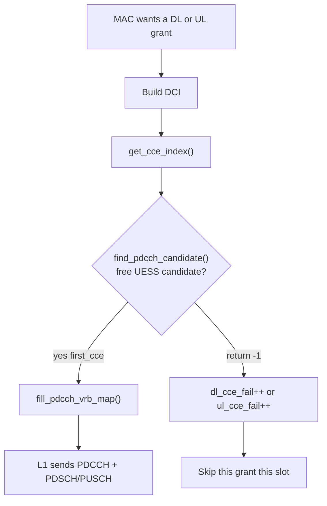
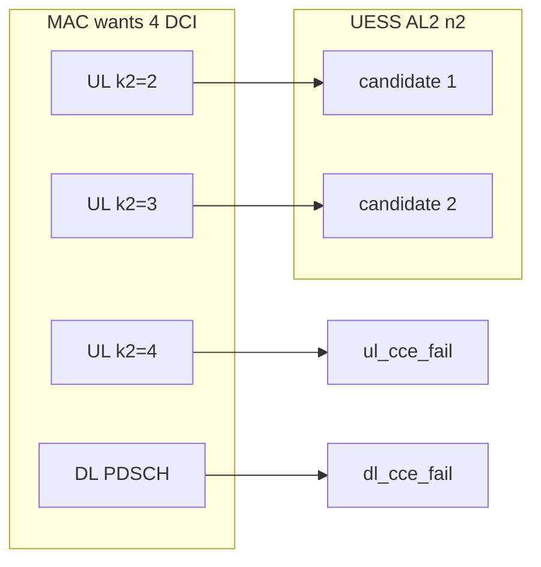

# CCE at the gNB — PDCCH resource and why DL stalls

**Author:** LATUAN · **2026.10.28** · `LATUAN_GNB_CCE`

CCE is **Control Channel Element**. It is the unit the gNB MAC uses to place a DCI on PDCCH. No free CCE means no DCI, so no PDSCH/PUSCH grant that slot — even when CQI, RI and MCS look perfect.

Lab context: OAI gNB, n79 100 MHz, 273 PRB, 4×4, **DSUUU** (O-RU pattern-id 3). Live UDP DL sat at **296 Mbit/s** while air theory is **~630–650 Mbit/s**. The limiter was `CCE fail`, not RF.

Source tree: `openairinterface5g-v26.w14`.

## 1. What a CCE is

PDSCH carries user bits. PDCCH carries **DCI**: which RNTI, which PRBs, which MCS, which HARQ process. The UE will not decode a PDSCH that has no matching DCI.

3GPP stacks the control region like this (TS 38.211 §7.3.2, TS 38.213 §10):

```text
  1 RE     = 1 subcarrier × 1 symbol
  1 REG    = 12 RE  (one RB × one OFDM symbol)
  1 CCE    = 6 REG  = 72 RE
  1 DCI    = L CCE  (aggregation level L = 1, 2, 4, 8 or 16)
```

| Name | Meaning |
|---|---|
| **CORESET** | Rectangle of RBs × symbols reserved for PDCCH |
| **REG** | One PRB in one CORESET symbol |
| **CCE** | Six REGs. Smallest piece the scheduler can allocate |
| **Aggregation level (AL)** | How many CCEs one DCI occupies |
| **Search space** | Which CCE start positions the UE must try |
| **Candidate** | One legal start CCE at a given AL |

AL is a reliability vs capacity trade. AL 1–2 uses few CCEs and fits many DCIs. AL 8–16 is more robust on a bad channel and **uses up the CORESET**.

OAI picks AL from channel quality (`pdcch_cl_adjust`, 0 = good, 1 = bad) in `determine_aggregation_level_search_order()`, then walks candidates in `find_pdcch_candidate()` (`gNB_scheduler_primitives.c`).



## 2. How many CCEs a CORESET has

```text
N_REG  = N_RB_coreset × N_symb_coreset
N_CCE  = N_REG / 6
```

OAI computes the same in `find_pdcch_candidate()`:

```c
const int N_rb   = pdcch->n_rb;          // RBs of CORESET per symbol
const int N_symb = coreset->duration;    // CORESET symbols
const int N_regs = N_rb * N_symb;
const int N_cces = N_regs / NR_NB_REG_PER_CCE;  // 6 REG per CCE
```

A candidate is taken if any of its REGs already sit in `vrb_map` (another DCI, or overlap with a reserved symbol). First free candidate wins. None free → `-1`.

SIB1 / CORESET0 size comes from TS 38.213 Table 13-6 (μ = 1, ≥24 RB). Lab knobs:

| `initialDLBWPcontrolResourceSetZero` | Duration | Typical use on this cell |
|---|---|---|
| **0** | 2 symbols | More CCE, TDA TypeA **2+12 / 2+8** |
| **4** (live P1) | **1 symbol** | Fewer CCE, TDA **1+13 / 1+9** (more PDSCH RE) |

P1 bought PDSCH REs and spent **CORESET0** budget (SIB1 / CSS only). After attach the UE uses a **dedicated CORESET** on the full BWP: ~240 RB × 1 symbol ≈ **40 physical CCE**. That rectangle is *not* empty on this lab cell. What runs out is the **UE-specific search space** (next section).

## 3. Where the gNB spends CCE

Every DCI burns CCE in a **DL or mixed slot only**. UL slots have no PDCCH.

Same CORESET in one slot may need:

| DCI | Why |
|---|---|
| DL grant (DCI 1_1 / 1_0) | PDSCH for iperf / DRB |
| UL grant (DCI 0_1 / 0_0) | PUSCH, including keepalive `min_grant_prb` |
| Retransmission DCI | HARQ retx, still needs a new PDCCH |
| CSI / other | Periodic or aperiodic trigger |

DSUUU @ 30 kHz, period 2.5 ms:

```text
slot   0    1    2    3    4
role   D    S    U    U    U
PDCCH  yes  yes  no   no   no
```

**400 periods/s × 2 PDCCH slots = 800 PDCCH occasions/s** for *all* DL and UL DCI. Three UL slots still need grants from those two occasions.

```text
          one DSUUU period = 2.5 ms
  slot    0        1        2        3        4
          D        S        U        U        U
  PDCCH   yes      yes      no       no       no
            \                ^        ^        ^
             \____ k2=2 _____/        |        |
              \____ k2=3 ____________/        |
               \____ k2=4 ____________________/
               + DL DCI on D itself
```

From **one slot D**, `min_rxtxtime = 2` lets the UL scheduler emit DCI for **U2, U3 and U4**. That is **three UL DCI + one DL DCI** competing for the same PDCCH occasion.

## 4. `CCE fail` in `nrMAC_stats.log`

Printed in `main.c` from `sched_ctrl->dl_cce_fail` and `ul_cce_fail`. Incremented when `get_cce_index()` returns `< 0` (`gNB_scheduler_ulsch.c` UL path; same pattern on DL).

```
UE rnti: … BLER … MCS (…) xx NPRB yy CCE fail N
```

| Field | Meaning |
|---|---|
| `CCE fail` on the **dlsch** line | `dl_cce_fail` — could not place a **DL** DCI |
| `CCE fail` on the **ulsch** line | `ul_cce_fail` — could not place a **UL** DCI |
| Rising while MCS/CQI stay good | Search space / scheduler, **not** RF |
| `NPRB 0` after a test | Idle snapshot; read counters **during** iperf |

`CCE fail` is cumulative from attach. Compare the **delta** over a 20 s UDP run, not the absolute number.

## 5. Why it “runs out” — 2 search-space seats, not 40 CCE

After RRC the UE monitors a **UE-specific search space (UESS)**. OAI default in `gnb_config.c`:

```text
AL1 n0   AL2 n2   AL4 n0   AL8 n0   AL16 n0
```

CQI 15 → MAC picks **AL = 2**. `n2` means **two candidates**. `find_pdcch_candidate()` only walks those two start positions. A third DCI in the same slot gets `-1` even if ~38 of 40 CCE in the dedicated CORESET are still free.

```text
  dedicated CORESET (~40 CCE)     ████████████████████████  empty
  UESS seats (AL2 n2)             ██  only these two legal
```

```text
  slot D, typical DSUUU + keepalive

  order   what MAC tries          UESS seat      counter
  1       UL DCI → U2 (k2=2)      candidate 1    ok
  2       UL DCI → U3 (k2=3)      candidate 2    ok
  3       UL DCI → U4 (k2=4)      none           ul_cce_fail++
  4       DL DCI → PDSCH          none           dl_cce_fail++
```

UL `pf_ul` runs **before** DL in the slot, so the two seats go to UL first. DL is the one left outside. That is the “kênh điều khiển hết chỗ”: **hết ứng viên search space**, không hết RE CORESET.



Override is `gNBs.uess_agg_levels` (5 ints: AL1…AL16 candidate enum). Example to open four AL2 seats: `uess_agg_levels = (0, 4, 0, 0, 0);` then re-attach the UE.

## 6. Lab case — DSUUU 296 Mbit/s UDP vs ~650 theory

Live `/etc/oai-gnb/conf/gnb.conf` (2026-10-28): DSUUU, 273 PRB, CORESET0 **= 4**, `dl_max_mcs = 27`, `min_rxtxtime = 2`.

Air was already at the ceiling:

| | Live (UE `987e`) | Needed for peak |
|---|---|---|
| CQI / RI / Qm | 15 / 4 / 8 | same |
| RSRP | −51 dBm | good |
| MCS | 27 | cap |
| BLER | 0.00 | good |
| HARQ retx | ~0.7% | good |

MAC theory (TBS in **bytes**, same formula as the DDSUU P1 note):

```text
N_period = 1000 / 2.5 = 400 /s
MAC_bps  = (N_D × TBS_D + N_S × TBS_S) × 8 × N_period

DSUUU: N_D = 1, N_S = 1
P1 TDA 1+13 / 1+9, MCS 26 L=4: TBS_D ≈ 116669, TBS_S = 81975
MAC ≈ (116669 + 81975) × 8 × 400 = 636 Mbit/s
MCS 27 ≈ 655 Mbit/s
UDP iperf ≈ MAC  (little RLC/TCP overhead)  →  630–650 Mbit/s
```

Measured UDP **296 Mbit/s** ≈ **47%** of 636. Same UE later in the run (still CQI 15 / RI 4 / MCS 25–27):

| Counter | Mid-run | Later same attach |
|---|---|---|
| `dlsch` first TX | 247870 | 766226 |
| `dl_cce_fail` | **158310** | **498831** (~39% of DL attempts) |
| `ulsch` first TX | 641679 | 1676576 |
| `ul_cce_fail` | — | **494895** (~23% of UL attempts) |
| UL vs DL grants | UL **2.6×** DL | UL **2.2×** DL |

Fail rate DL > UL matches the schedule order: UL takes the two UESS seats, DL loses. UL still fails the third k2. This is **not** a counter bug and **not** an empty physical CORESET.

```text
WANT PDSCH
  → need DCI on PDCCH
    → need a free UESS candidate (default: 2 × AL2)
      → DSUUU: 3 UL targets from slot D + 1 DL
        → CCE fail → skip grant → UDP ~half of theory
```

## 7. How to read a run

During a **DL-only** UDP offer (~1 Gbit/s, no UL iperf):

```bash
# live TDD + CORESET
grep -E 'nrofDownlinkSlots|nrofUplinkSlots|controlResourceSetZero|dl_max_mcs' \
  /etc/oai-gnb/conf/gnb.conf

# 20 s sample
tail -n 20 /var/log/oai-gnb/nrMAC_stats.log
```

Pass for “air is not the limit”:

1. `CQI` ≥ 10, `RI` = 4, `Qm` = 8, `MCS` 26–27, `NPRB` **273**
2. `BLER` ≪ 0.05, `pucch0_DTX` not climbing
3. `CCE fail` **delta ≈ 0** over the 20 s

If (1)+(2) pass and (3) climbs → CCE/PDCCH is the ceiling. If (1) fails → fix RF/CSI first (yesterday’s CQI 0 / RI 1 case).

## 8. Levers (do not mix with RF knobs)

| Lever | Effect on CCE | Side effect |
|---|---|---|
| Iperf **DL only** | Frees the two UESS seats for DL DCI | Measure UL separately |
| Lower `ul_max_mcs` / quieter `min_grant_prb` while measuring DL | Fewer UL DCI from slot D | UL rate drops |
| `uess_agg_levels = (0, 4, 0, 0, 0)` | AL2 **n4** = 4 candidates | Re-attach UE; UE blind-decode load up |
| CORESET0 **4 → 0** (2 symbols) | More **CSS/SIB1** CCE only | TDA **2+12 / 2+8**, mixed TBS down; **does not** add UESS candidates |
| Stay on DDSUU (2 D + 1 S) | 1200 PDCCH slots/s, fewer UL k2 from one D | Different RU pattern-id |
| Higher AL (bad `pdcch_cl_adjust`) | Each DCI costs more CCE | Worse fail rate if candidates stay at 2 |

Do not raise `dl_max_mcs` or chase 256QAM when `CCE fail` is climbing and CQI/RI are already at the cap. Extra CORESET symbols without extra UESS candidates will not clear this fail.

## 9. Code map

| Piece | File |
|---|---|
| CCE count, candidate search | `openair2/LAYER2/NR_MAC_gNB/gNB_scheduler_primitives.c` — `find_pdcch_candidate()`, `get_cce_index()` |
| Mark CCE used | same file — `fill_pdcch_vrb_map()` |
| Default UESS AL2 n2 | `openair2/GNB_APP/gnb_config.c` — `uess_num_agg_level_candidates` |
| Conf override | `gNBs.uess_agg_levels` — `GNB_CONFIG_STRING_UESS_AGG_LEVEL_LIST` |
| UL miss → `ul_cce_fail++` | `openair2/LAYER2/NR_MAC_gNB/gNB_scheduler_ulsch.c` |
| DL miss → `dl_cce_fail++` | `openair2/LAYER2/NR_MAC_gNB/gNB_scheduler_dlsch.c` |
| Print `CCE fail` | `openair2/LAYER2/NR_MAC_gNB/main.c` |
| Counters | `nr_mac_gNB.h` — `dl_cce_fail`, `ul_cce_fail`, `aggregation_level` |
| CORESET0 index | `gNBs.servingCellConfigCommon.initialDLBWPcontrolResourceSetZero` |

## 10. One line

**CCE is the parking space for DCI. The lot has ~40 spaces; OAI only lets the UE use two of them (UESS AL2 n2).** DSUUU plus UL keepalive tries three UL grants and one DL grant from the same slot D. UL parks first. The rest print `CCE fail` and PDSCH is skipped. That is a search-space limit, not a 100 MHz or 4×4 air limit.
