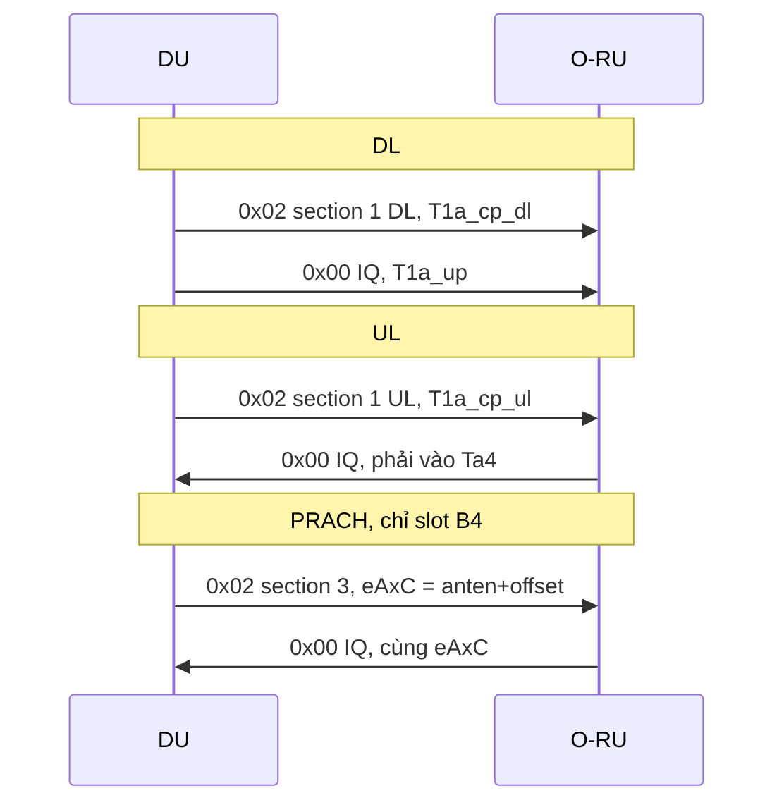

# O-RAN eCPRI at the DU — debug sheet

**Author:** LATUAN · **2026.10.20**

FHI **7.2x**: DU giữ IQ tần số, O-RU làm FFT/IFFT. Gói đi DPDK trên VF (`fhi_72.dpdk_devices`), ethertype **0xAEFE**, tới MAC `fhi_72.ru_addr`. Không phải UDP.

Đường `udp_ecpri_if5` là split 8, time-domain, không dùng khi DU nói chuyện với O-RU.

## 1. Một quy tắc

DU là nguồn C-plane. DU không bao giờ nhận C-plane. Log `O-DU recevied C-Plane message!` nghĩa là O-RU đang gửi nhầm vai.

| Luồng | DU gửi | O-RU gửi | eAxC | Section | IQ width |
|---|---|---|---|---|---|
| DL | C-plane rồi U-plane | không | anten `0…3` | 1, hướng DL | 9 |
| UL | chỉ C-plane | U-plane | anten `0…3` | 1, hướng UL | 9 |
| PRACH | chỉ C-plane, đúng slot | U-plane | anten **+ offset** (mặc định 4) | 3, hướng UL, `filterIndex` 3 | 16 |

Offset PRACH nằm trên cổng PUSCH. `eAxC >= offset` thì DU đếm `rx_prach_packets`, không đếm `rx_pusch_packets`.



## 2. Đọc một gói

Bốn field quyết định gói là gì. Đọc theo thứ tự này trong pcap.

| Thứ tự | Field | DL / UL data | PRACH |
|---|---|---|---|
| 1 | eCPRI type | `0x02` lệnh, `0x00` IQ | giống vậy |
| 2 | Hướng trong app header | DL = 1, UL = 0 | UL = 0 |
| 3 | Section type (chỉ có trên `0x02`) | 1 | 3 |
| 4 | eAxC (`ecpri_xtc_id`) | `0…3` | `4…7` nếu offset = 4 |

C-plane không chứa IQ. Nó chỉ mang symbol, PRB, và với PRACH thêm `freqOffset`, `timeOffset`, SCS. U-plane mang IQ của đúng symbol đó, cùng eAxC với lệnh vừa gửi.

Cửa sổ của cell 100 MHz n79 (`fhi_72.fh_config`, µs trước symbol trên không):

| Cửa sổ | Giá trị | Gói nào |
|---|---|---|
| `T1a_cp_dl` | 240–450 | DL C-plane |
| `T1a_up` | 115–325 | DL U-plane |
| `T1a_cp_ul` | 20–350 | UL và PRACH C-plane |
| `Ta4` | 75–99 | UL và PRACH U-plane mà DU nhận |

S-plane không nằm trong gói eCPRI. PTP ở PF `ice`. Lệch cửa sổ thì sửa PTP trước, đừng sửa section.

## 3. Triệu chứng

Log mỗi 128 frame, slot 0, `oaioran.c`:

```
[o-du 0][rx … pps …][tx … pps …]
[o-du 0][FH-RT on_time … early … late … corrupt … dupl …]
[o_du0][pusch0 … prach0 …]
```

| Thấy | Nghĩa | Nhìn tiếp |
|---|---|---|
| `tx` pps = 0 | DU không phát | VF, hugepage, `ru_addr`, `xran_prepare_cp_*_slot` |
| `tx` tăng, `rx` = 0 | Lệnh ra, IQ không về | MAC O-RU, MTU 9000, VLAN, PTP |
| `late` tăng | IQ về sau `Ta4` | PTP / `Ta4`, không phải nội dung section |
| `early` tăng | IQ về trước cửa sổ | cùng PTP, lệch ngược |
| `pusch` tăng, `prach` = 0 | PUSCH sống, lệnh PRACH không được trả lời | `generate_cpmsg_prach`, slot index 159, eAxC offset |
| `prach` tăng mà không dò ra preamble | IQ về đúng cổng, nội dung lệch | `freqOffset`, `kbar` (mặc định 4), `iq_width_prach` 16 |
| `corrupt` / `dupl` | Header hoặc seq id | MTU cắt gói, seq `e_bit` |
| Log O-DU received C-plane | O-RU gửi type `0x02` | Vai O-RU, không phải bug parser DU |

`on_time` / `early` / `late` chỉ tính U-plane DU nhận. Cửa sổ C-plane nằm ở O-RU. DU gửi C-plane trễ thì `rx` và `pusch` đứng, `late` không tăng.

## 4. Chỗ dừng khi debug

| Việc | Hàm |
|---|---|
| Dựng DL C-plane | `xran_prepare_cp_dl_slot()` |
| Dựng UL C-plane, rồi PRACH nếu đúng slot | `xran_prepare_cp_ul_slot()` |
| Điền section 3 | `generate_cpmsg_prach()` |
| Ghi eCPRI type `0x02` và eAxC | `xran_build_ecpri_hdr()` |
| Đẩy gói ra ring | `send_cpmsg()` |
| Tách type khi nhận | `handle_ecpri_ethertype()` |
| eAxC ≥ offset → PRACH, còn lại PUSCH | `xran_common.c` (nhánh `rx_prach_packets`) |
| Bỏ RE guard trước detector | `oaioran.c`, `g_kbar` |
| In counter | `oaioran.c`, khoảng frame `& 0x7f` |

Header: `fhi_lib/lib/api/xran_pkt.h`, `xran_pkt_cp.h`. Cấu hình cell: `configs/gnb/002.gnb.sa.e2e.band79.100mhz.273.fhi72.4x4.conf`.
