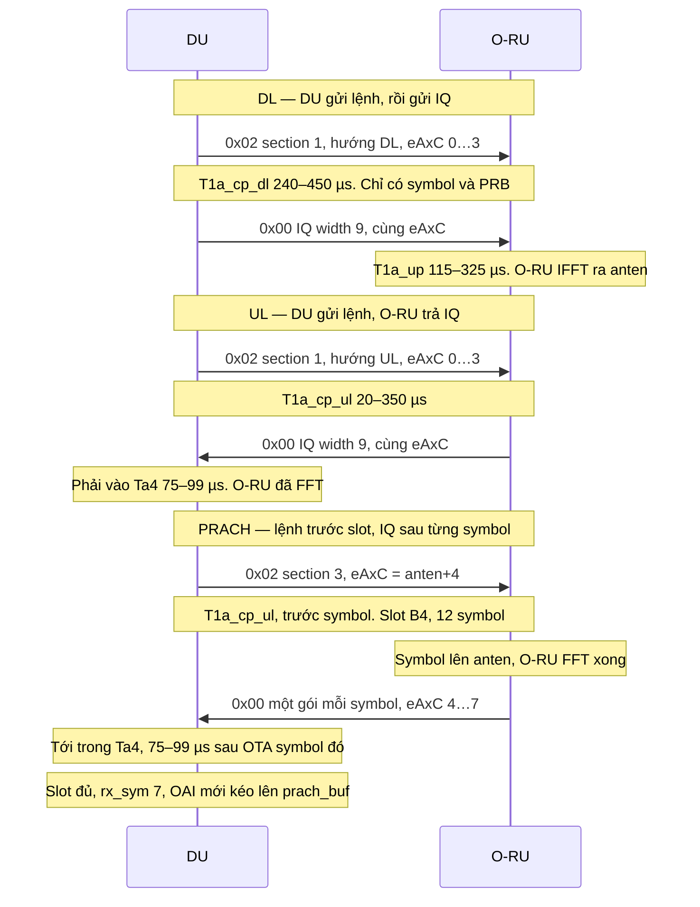

# O-RAN eCPRI at the DU — debug sheet

**Author:** LATUAN · **2026.10.20**

FHI **7.2x**. DU giữ IQ tần số. O-RU làm FFT và IFFT. Gói là Ethernet `0xAEFE` trên DPDK, tới MAC `fhi_72.ru_addr`. Không phải UDP, và không phải đường `udp_ecpri_if5`.

DU là bên gửi mọi C-plane. Có hai loại gói: `0x02` là lệnh, không có IQ; `0x00` là IQ. Lệnh và IQ của cùng một symbol đi cùng một eAxC.

## Một slot

Đọc hình từ trên xuống. Mỗi mũi tên là một gói trên dây.



**DL.** `xran_prepare_cp_dl_slot()` gửi section type 1, hướng DL, eAxC = số anten (`0…3`), IQ width 9. Gói này chỉ chỉ symbol và PRB. Sau đó DU gửi U-plane cùng eAxC. O-RU nhận IQ tần số và làm IFFT. DU không chờ gói trả về.

**UL.** `xran_prepare_cp_ul_slot()` gửi section type 1, hướng UL, cùng eAxC `0…3`. O-RU làm FFT rồi trả U-plane. DU phải nhận trong `Ta4`. Không có U-plane chiều UL từ DU.

**PRACH.** Cùng hàm UL, chỉ khi slot là PRACH (config index 159, format B4, dài 12 symbol). `generate_cpmsg_prach()` gửi section type 3, hướng UL, `filterIndex` 3, IQ width 16, kèm `freqOffset` và `timeOffset`. eAxC = anten + offset, mặc định 4, nên cổng là `4…7`. O-RU trả IQ trên đúng eAxC đó. `xran_common.c` thấy eAxC ≥ offset thì đếm `rx_prach_packets`. OAI bỏ `kbar` RE (mặc định 4) rồi mới dò preamble.

U-plane PRACH không đi cùng lệnh. O-RU phát **một gói `0x00` cho mỗi symbol PRACH**, sau khi symbol đó đã lên anten và FFT xong. Gói phải tới DU trong `Ta4`, tức **75–99 µs sau thời điểm OTA của chính symbol đó** (`xran_cb_proc.c` đo `Ta4_min` / `Ta4_max` so với OTA). Ở 30 kHz, một symbol dài khoảng 36 µs, nên cửa sổ này rơi khoảng 2 đến 3 symbol sau symbol trên không. Sớm hơn 75 µs là `early`. Muộn hơn 99 µs là `late`.

Gói rơi vào buffer xRAN ngay khi nhận. OAI chỉ kéo cả occasion lên `ru->prach_buf` khi slot UL đủ, callback `oai_xran_fh_rx_callback()` với `rx_sym == 7`, rồi `xran_fh_rx_read_slot()` gọi `read_prach_data()`.

## Khi cầm một gói

Đọc bốn field theo thứ tự. Dừng ở field đầu tiên không khớp hình ở trên.

| Field | DL | UL | PRACH |
|---|---|---|---|
| eCPRI type | `0x02` rồi `0x00` | `0x02` từ DU, `0x00` từ O-RU | giống UL |
| Hướng | 1 | 0 | 0 |
| Section type, chỉ trên `0x02` | 1 | 1 | 3 |
| eAxC | `0…3` | `0…3` | `4…7` |

`T1a_*` là µs **trước** symbol trên không. `Ta4` là µs **sau** OTA của chính symbol đó. Cell 100 MHz n79, 30 kHz, một symbol khoảng 36 µs. S-plane không nằm trong gói. PTP ở PF `ice`. Lệch cửa sổ thì sửa PTP, đừng sửa section.

| Cửa sổ | µs | So với symbol | Gói |
|---|---|---|---|
| `T1a_cp_dl` | 240–450 | trước | DL `0x02` |
| `T1a_up` | 115–325 | trước | DL `0x00` |
| `T1a_cp_ul` | 20–350 | trước | UL và PRACH `0x02` |
| `Ta4` | 75–99 | sau OTA | UL và PRACH `0x00`. PRACH: một gói mỗi symbol |

## Khi gói không về

Log mỗi 128 frame, slot 0, trong `oaioran.c`:

```
[o-du 0][rx … pps …][tx … pps …]
[o-du 0][FH-RT on_time … early … late … corrupt … dupl …]
[o_du0][pusch0 … prach0 …]
```

`early` / `late` / `on_time` chỉ đếm U-plane DU nhận. C-plane trễ thì `rx` đứng, `late` không tăng, vì cửa sổ C-plane nằm ở O-RU.

| Log | Gói nào đứt | Dừng ở |
|---|---|---|
| `tx` pps = 0 | Không có mũi tên nào ra khỏi DU | VF, `ru_addr`, `xran_prepare_cp_dl_slot` / `xran_prepare_cp_ul_slot` |
| `tx` tăng, `rx` = 0 | Lệnh ra, IQ UL không về | MAC O-RU, MTU 9000, PTP |
| `late` tăng | IQ về sau `Ta4` | PTP, giá trị `Ta4` |
| `early` tăng | IQ về trước cửa sổ | PTP, lệch ngược |
| `pusch` tăng, `prach` = 0 | Section 3 không được trả lời | `generate_cpmsg_prach`, slot 159, eAxC offset |
| `prach` tăng, không dò ra | IQ đúng cổng, nội dung lệch | `freqOffset`, `g_kbar`, `iq_width_prach` |
| `corrupt` hoặc `dupl` | Header hoặc seq id | MTU, `e_bit` |
| `O-DU recevied C-Plane message!` | O-RU gửi `0x02` | Vai O-RU. DU không parse C-plane nhận vào |

| Việc trên hình | Hàm |
|---|---|
| Ghi type `0x02` và eAxC | `xran_build_ecpri_hdr()` |
| Đẩy gói ra dây | `send_cpmsg()` |
| Tách type lúc nhận | `handle_ecpri_ethertype()` |
| Chọn PUSCH hay PRACH | `xran_common.c`, nhánh `rx_prach_packets` |
| Ghi IQ PRACH lúc gói tới | `xran_process_prach_sym()` |
| Cửa sổ 75–99 µs sau OTA | `xran_cb_proc.c`, `Ta4_min` / `Ta4_max` |
| Kéo cả occasion lên L1 | `oai_xran_fh_rx_callback()` khi `rx_sym == 7`, rồi `read_prach_data()` |
| Bỏ RE guard | `oaioran.c`, `g_kbar` |

Header nằm ở `fhi_lib/lib/api/xran_pkt.h` và `xran_pkt_cp.h`. Số của cell này nằm ở `configs/gnb/002.gnb.sa.e2e.band79.100mhz.273.fhi72.4x4.conf`.
